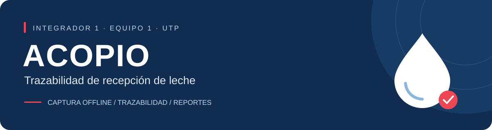
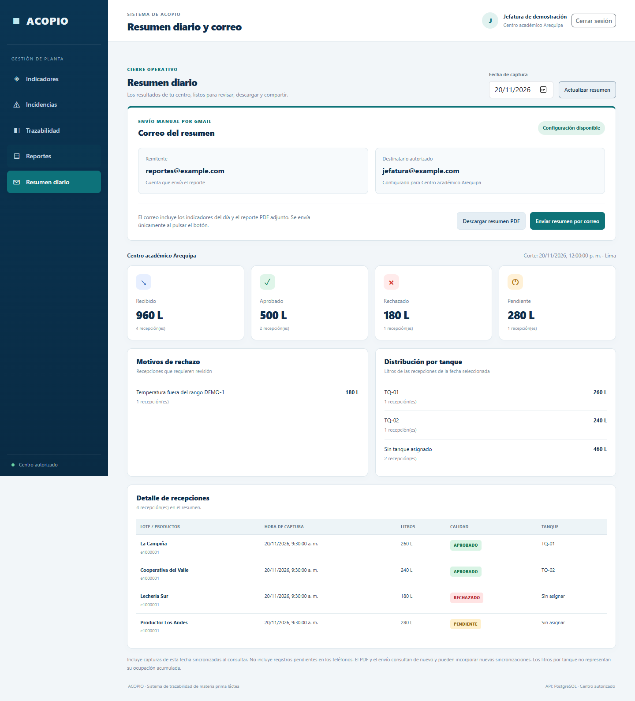
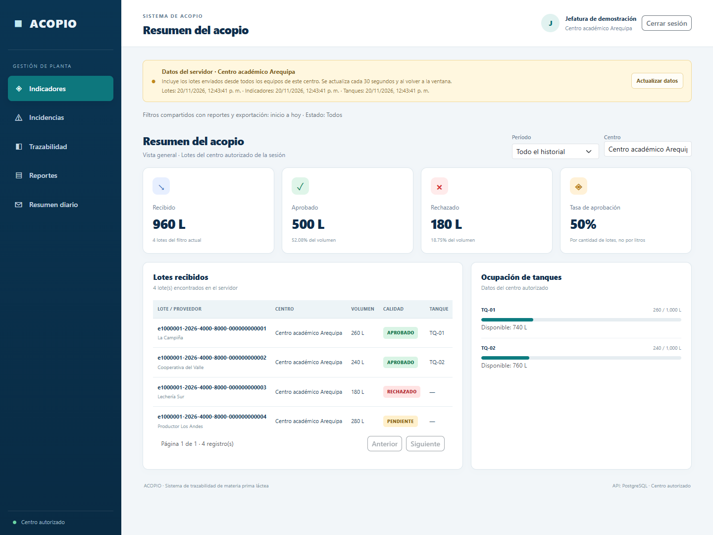
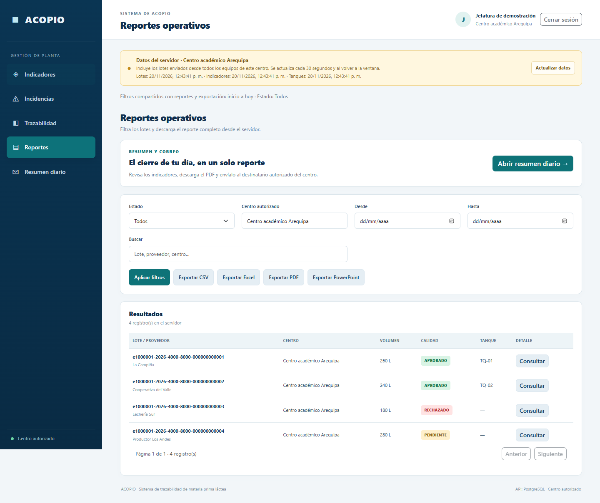
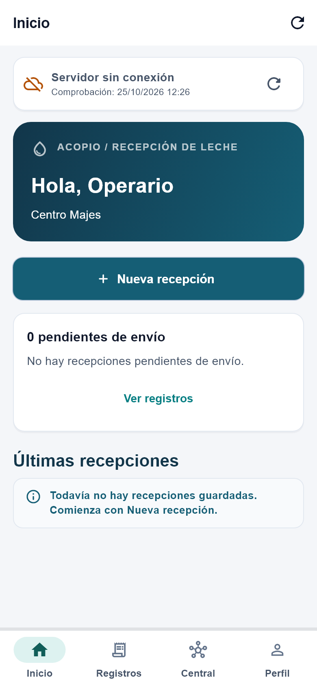
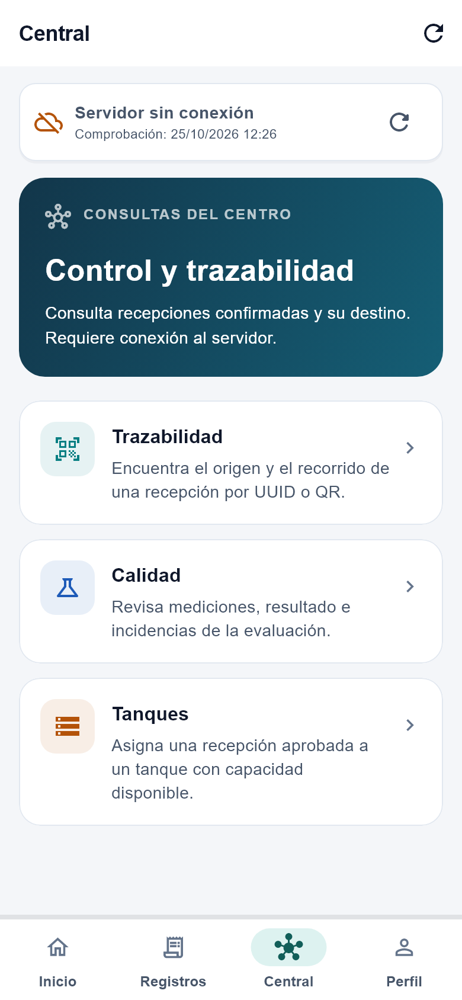
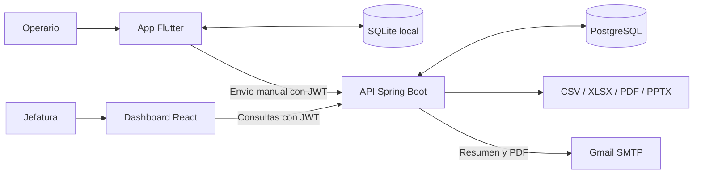

<div align="center">



**Registro, validación y trazabilidad de la recepción de leche**

Flutter + SQLite · Java 17 + Spring Boot · PostgreSQL · React · JasperReports

[Inicio rápido](#inicio-rápido) · [Interfaces](#interfaces) · [Reportes](#reportes-y-plantillas) · [Correo](#resumen-diario-por-correo) · [Verificación](#pruebas-y-evidencias)

</div>

## El proyecto

ACOPIO permite registrar recepciones de leche desde una app móvil, conservarlas sin conexión y enviarlas al servidor cuando el operario recupera conectividad. El backend evalúa la calidad y conserva procedencia, mediciones y destino; jefatura consulta los resultados de su centro desde el dashboard.

Tomamos como caso de estudio a Leche Gloria y utilizamos datos ficticios. Las reglas **DEMO-1** son parámetros académicos de demostración.

**Documentación actualizada al 20/11/2026.** Este README describe también los cambios del árbol de trabajo local que todavía no se han publicado: resumen diario, correo con Gmail, nueva vista del dashboard y ajustes del entorno. No presupone que la rama remota ya los contenga.

| Área | Disponible en el código local |
| --- | --- |
| **Operación móvil** | Captura offline, borradores, envío manual con reintento, consulta de calidad, QR y asignación de tanque. |
| **Supervisión web** | Indicadores, incidencias, trazabilidad, filtros, sesión conservada al recargar y resumen diario adaptable a móvil. |
| **Reportes** | CSV, Excel, PDF académico y PowerPoint editable; PDF específico del resumen diario. |
| **Correo** | Vista de remitente y destinatario por centro, envío manual del resumen con PDF adjunto y configuración local para Gmail. |
| **Datos y seguridad** | PostgreSQL, Flyway, JPA, BCrypt, JWT, permisos por rol y consultas limitadas al centro autenticado. |

## Interfaces

Las capturas del dashboard muestran **la interfaz actual con respuestas simuladas y datos ficticios**. Los correos `example.com` son ilustrativos; estas imágenes no acreditan una conexión a PostgreSQL ni entrega de correo real.

### Resumen diario y correo

Remitente, destinatario autorizado, indicadores, motivos de rechazo, distribución por tanque y detalle del día en una misma pantalla.

<p align="center">
  
</p>

### Indicadores y exportaciones

<table>
  <tr>
    <th width="50%">Indicadores del centro</th>
    <th width="50%">Reportes operativos</th>
  </tr>
  <tr>
    <td valign="top"></td>
    <td valign="top"></td>
  </tr>
  <tr>
    <td>Consulta de lotes y capacidad disponible de tanques.</td>
    <td>Filtros compartidos entre la consulta y los cuatro formatos.</td>
  </tr>
</table>

### Aplicación móvil

<table>
  <tr><th width="50%">Inicio del operario</th><th width="50%">Consulta central</th></tr>
  <tr>
    <td align="center"></td>
    <td align="center"></td>
  </tr>
</table>

Estas vistas móviles corresponden al tercer avance y usan datos ficticios. Las capturas originales del recorrido comprobado se conservan en [Evidencias del recorrido](mobile-flutter/docs/EVIDENCIAS_RECORRIDO.md).

## Recorrido y permisos

1. El **operario** inicia sesión y descarga catálogos del centro.
2. Captura origen, volumen y mediciones; guarda el registro y su UUID en SQLite.
3. Solicita el envío cuando hay conexión. Los reintentos conservan la misma solicitud.
4. El backend valida referencias, identifica duplicados y evalúa calidad dentro de la transacción.
5. Una recepción aprobada puede asignarse a un tanque del mismo centro, con capacidad suficiente.
6. **Jefatura** consulta los registros confirmados, exporta reportes y envía el resumen diario.

| Rol | Acceso y responsabilidades |
| --- | --- |
| `OPERARIO` | App Flutter: registrar, enviar, consultar calidad/trazabilidad y asignar destino. |
| `JEFATURA` | Dashboard: indicadores, incidencias, trazabilidad, reportes y correo. La API permite administrar proveedores y vehículos. |

El trabajo offline requiere sesión vigente y catálogos descargados. Guardar localmente no significa haber enviado el registro; un lote rechazado por calidad sí puede estar recibido por el servidor. La asignación del tanque es un registro digital y no controla dispositivos físicos.

## Arquitectura y organización



```text
ACOPIO/
├── backend/                    API, reglas, seguridad, persistencia y exportadores
│   ├── mvnw.cmd                Maven Wrapper para Windows
│   └── src/test/               Pruebas Java e integración con una base separada
├── dashboard/                  Interfaz React, estilos y pruebas
├── mobile-flutter/             App, SQLite, ViewModels y pruebas móviles
├── database/                   Referencia SQL y datos ficticios de demostración
├── docs/
│   ├── assets/readme/          Capturas ilustrativas de este documento
│   ├── plantillas-academicas/  Fuentes JRXML editables en Jaspersoft Studio
│   └── pruebas/               Matrices y evidencias fechadas
├── scripts/                    Preparación, arranque, pruebas y configuración de correo
├── .local/                     Configuración privada y archivos generados; ignorada por Git
├── Acopio.code-workspace       Espacio de trabajo de VS Code
└── README.md
```

La app aplica **MVVM**, Riverpod y `ChangeNotifier`; los repositorios gestionan SQLite. El backend separa controladores, servicios, reglas de calidad, entidades y repositorios JPA. Flyway administra las migraciones y Spring Security valida identidad, rol y centro.

| Tecnología | Uso concreto |
| --- | --- |
| Java 17, Spring Boot y JPA/Hibernate | API y operaciones transaccionales. |
| PostgreSQL 18 y Flyway | Nueve tablas de negocio e historial de migraciones. |
| Flutter, Dart, Riverpod y SQLite | Captura móvil y persistencia offline. |
| React, Vite y Bootstrap | Dashboard y navegación adaptable. |
| JasperReports | PDF académico, PowerPoint y resumen diario PDF. |
| Apache POI / Commons CSV | Exportaciones Excel / CSV. |
| Spring Mail / Jakarta Mail | Mensajes SMTP y adjuntos PDF. |
| Guava / Logback | Huella SHA-256 de solicitudes / diagnóstico técnico. |

Las versiones se declaran en [pom.xml](backend/pom.xml), [package.json](dashboard/package.json) y [pubspec.yaml](mobile-flutter/pubspec.yaml). Las credenciales, logs, base local y copias temporales no se publican. El material de apoyo se conserva fuera del repositorio; las evidencias de entrega pertenecen a `docs/`.

## Inicio rápido

### 1. Requisitos

| Herramienta | Consideración |
| --- | --- |
| Git y PowerShell | Entorno de trabajo en Windows. |
| Java 17 | API y entorno Android compartido. |
| Maven Wrapper | Incluido en `backend/mvnw.cmd`; no se exige Maven global. |
| Node.js y npm | Dependencias, pruebas y compilación del dashboard. |
| PostgreSQL 18 | Herramientas `initdb`, `pg_ctl`, `psql` y `createdb`. |
| Flutter y Android SDK | Necesarios para la preparación completa y la app móvil. |
| Jaspersoft Studio | Opcional: edición visual de las plantillas de reportes. |

### 2. Preparar el equipo

Desde la raíz del repositorio:

```powershell
powershell.exe -NoProfile -ExecutionPolicy Bypass -File .\scripts\Preparar.ps1
```

El script instala dependencias, inicializa PostgreSQL y ejecuta compilación y pruebas, incluyendo Flutter. Un fallo de las pruebas móviles debe revisarse por separado; no representa por sí solo un fallo de backend o dashboard.

Las rutas se pueden ajustar con `ACOPIO_JAVA_HOME`, `ACOPIO_PG_BIN` y `ACOPIO_NODE`. [.env.example](.env.example) documenta variables y no se carga automáticamente. La contraseña de PostgreSQL y el secreto JWT se generan en `.local/`.

### 3. Iniciar, comprobar y detener

```powershell
.\Iniciar.cmd
.\Verificar.cmd
.\Detener.cmd
```

| Servicio | Dirección local |
| --- | --- |
| Dashboard | http://127.0.0.1:5173 |
| API | http://127.0.0.1:18080 |
| Estado de API y base | http://127.0.0.1:18080/api/estado |
| Salud de la aplicación | http://127.0.0.1:18080/actuator/health |
| PostgreSQL | `127.0.0.1`, base y usuario `acopio_dev`; puerto configurable. |

**Puerto PostgreSQL:** el valor predeterminado es `55440`. `Dev.ps1` prioriza `ACOPIO_DB_PORT`, luego `.local/db-port.txt`. En el equipo de desarrollo se cambió a `55430` porque Windows reservó el puerto anterior. En pgAdmin debe usarse el mismo puerto y la contraseña local del equipo.

### 4. Acceder al entorno de demostración

| Interfaz | Cuenta ficticia | Contraseña inicial |
| --- | --- | --- |
| App móvil | `operario@gloria.com.pe` | `123456` |
| Dashboard | `jefatura@gloria.com.pe` | `123456` |

Las cuentas son de demostración; si se cambiaron las claves se usan las vigentes. La contraseña de PostgreSQL es independiente de estas cuentas.

Para cargar recepciones ficticias de Equipo 1, revisar y ejecutar [demo_reportes_equipo1.sql](database/demo_reportes_equipo1.sql) sobre la base de desarrollo, desde pgAdmin. El script identifica sus datos de muestra; no se utiliza sobre una base de operación real.

<details>
<summary><strong>Conectar un teléfono Android</strong></summary>

Con depuración USB autorizada:

```powershell
.\Abrir_Flutter.cmd
```

El lanzador selecciona el teléfono, configura `adb reverse` y usa `http://127.0.0.1:18080`. Si hay varios dispositivos:

```powershell
powershell.exe -NoProfile -ExecutionPolicy Bypass -File .\scripts\Dev.ps1 -Action Mobile -DeviceId ID_DEL_CELULAR
```

En el emulador Android estándar, usar `http://10.0.2.2:18080` como `API_BASE_URL`. El proceso Flutter termina con `q` en su terminal. La configuración iOS no está validada.

</details>

## Reportes y plantillas

En **Reportes**, los formatos operativos comparten los filtros `estado`, `desde`, `hasta` y `buscar`, y el centro del JWT. La fecha se interpreta en `America/Lima`. El máximo es de **10.000 recepciones** por reporte.

| Formato | Generación | Uso |
| --- | --- | --- |
| **CSV** | Commons CSV | Intercambio de datos; texto protegido frente a fórmulas. |
| **Excel (.xlsx)** | Apache POI | Análisis tabular y mediciones numéricas. |
| **PDF (.pdf)** | JasperReports | Reporte académico con portada, detalle y totales. |
| **PowerPoint (.pptx)** | JasperReports | Presentación editable con portada, fichas de recepciones y resumen. |
| **Resumen diario PDF** | JasperReports | Indicadores del día, calidad, tanques y detalle; también se adjunta al correo. |

### Personalizar con Jaspersoft Studio

| Plantilla | Conectada al dashboard |
| --- | --- |
| `01_PDF_academico.jrxml` | Sí: Exportar PDF. |
| `02_Excel_academico.jrxml` | Diseño para Studio; la descarga Excel sigue generándose con POI. |
| `03_PowerPoint_academico.jrxml` | Sí: Exportar PowerPoint. |
| `04_Resumen_diario.jrxml` | Sí: descargar y enviar el resumen diario. |

Abrir [docs/plantillas-academicas](docs/plantillas-academicas) en Jaspersoft Studio y editar el JRXML en **Design**. Las plantillas académicas incluyen Equipo 1, Integrador 1, Universidad Tecnológica del Perú, periodo Agosto-2026 y docente Alberto Edú Fernández Bernedo.

Maven copia las fuentes al classpath durante la compilación. Guardar en Studio no actualiza un backend que ya está ejecutándose: hay que recompilar y reiniciar. Todavía no existe un editor de plantillas dentro del dashboard. CSV no admite diseño visual de colores o portada.

## Resumen diario por correo

**Resumen diario** tiene acceso propio en el menú y un enlace desde Reportes. Al entrar o cambiar de fecha carga indicadores, remitente, destinatario autorizado y estado de configuración de Gmail.

1. Seleccionar la fecha de captura y revisar el centro y destinatario.
2. Consultar los litros recibidos, aprobados, rechazados y pendientes.
3. Revisar motivos de rechazo, distribución por tanque y recepciones.
4. Descargar el PDF o pulsar **Enviar resumen por correo**.

El resumen incluye capturas del día seleccionado que ya están sincronizadas al consultar. Los registros todavía guardados en los teléfonos no aparecen. Las evaluaciones y asignaciones son las actuales al consultar; los litros por tanque corresponden a esas recepciones, no a su ocupación acumulada. La descarga y el envío consultan de nuevo, por lo que pueden incorporar sincronizaciones posteriores a la vista previa.

### Configurar Gmail

Activar verificación en dos pasos y crear una contraseña de aplicación en la cuenta remitente. Después ejecutar:

```powershell
powershell.exe -NoProfile -ExecutionPolicy Bypass -File .\scripts\Configurar-Correo.ps1
```

El asistente guarda remitente, destinatario por centro y contraseña en `.local/mail.properties`. La contraseña se introduce de forma oculta. Reiniciar el backend para aplicar los cambios.

El destinatario se configura mediante `app.mail.centros.ID.destinatario`; si no existe, se usa el correo del usuario autenticado. El navegador no puede elegir otro centro ni un destinatario arbitrario. SMTP utiliza autenticación y STARTTLS; se limita a un intento por minuto y destinatario.

El envío es **manual**. La configuración disponible no acredita entrega en la bandeja: el envío real por Gmail sigue pendiente de comprobación documentada. La integración actual cubre reportes y no incorpora todavía verificación de cuentas ni recuperación de contraseñas.

Ver [Guía del resumen diario](docs/resumen-diario.md) para configuración, API y tratamiento de errores.

## API y consistencia

<details>
<summary><strong>Rutas principales y permisos</strong></summary>

| Método y ruta | Acceso | Función |
| --- | --- | --- |
| `POST /api/auth/login` | Público | Autenticación y JWT. |
| `GET /api/estado`, `GET /actuator/health` | Público | Diagnóstico y salud. |
| `GET /api/catalogos/proveedores`, `/vehiculos`, `/centro` | OPERARIO / JEFATURA | Catálogos; las tres rutas parten de `/api/catalogos`. |
| `POST /api/lotes` | OPERARIO | Recepción y evaluación. |
| `GET /api/lotes`, `/api/lotes/{uuid}` | OPERARIO / JEFATURA | Listado y detalle del centro. |
| `GET /api/lotes/por-qr?codigo=ACOPIO:UUID` | OPERARIO / JEFATURA | Consulta por QR. |
| `GET /api/tanques` | OPERARIO / JEFATURA | Disponibilidad y capacidad. |
| `POST /api/lotes/{uuid}/asignacion-tanque` | OPERARIO | Destino de una recepción aprobada. |
| `GET /api/reportes` | JEFATURA | Indicadores del conjunto filtrado. |
| `GET /api/reportes/csv`, `/xlsx`, `/pdf`, `/pptx` | JEFATURA | Descargas; las cuatro rutas parten de `/api/reportes`. |
| `GET /api/reportes/diario?fecha=AAAA-MM-DD` | JEFATURA | Vista previa del resumen y configuración visible. |
| `GET /api/reportes/diario/pdf?fecha=AAAA-MM-DD` | JEFATURA | PDF diario. |
| `POST /api/reportes/diario/correo` | JEFATURA | Envío manual con cuerpo `{"fecha":"AAAA-MM-DD"}`. |
| `/api/administracion/catalogos/**` | JEFATURA | Administración de proveedores y vehículos. |

</details>

El centro y usuario de una solicitud se obtienen de la sesión. La paginación utiliza `pagina` y `tamano`. Un UUID reutilizado con contenido diferente genera conflicto; la huella SHA-256 normaliza instante, volumen y mediciones para permitir reintentos coherentes.

Las nueve tablas de negocio son `rol`, `centro_acopio`, `usuario`, `proveedor`, `vehiculo`, `tanque`, `lote_leche`, `registro_calidad` e `incidencia`. Las [migraciones Flyway](backend/src/main/resources/db/migration) son la fuente ejecutable; [modelo_original_informe.sql](database/modelo_original_informe.sql) es una referencia y no se ejecuta sobre una base ya administrada por Flyway.

## Pruebas y evidencias

Estas son las últimas verificaciones documentadas; editar este README no ejecuta de nuevo las suites.

| Componente | Comprobación | Alcance y límite |
| --- | --- | --- |
| **Backend · 18/11/2026** | Suite completa de **53 pruebas** aprobada; empaquetado correcto. | Base aislada `acopio_test`. Después se ejecutaron **5 pruebas específicas** de resumen/correo, todas aprobadas; no se suman como otra suite completa. |
| **Dashboard · 18/11/2026** | **12 pruebas** aprobadas y build de Vite correcto. | Fechas, QR y sesión, incluida restauración de Resumen diario. |
| **Navegador · 18/11/2026** | Acceso, menú, carga automática, destinatario corregido, fecha, descarga PDF, recarga y vista móvil comprobados. | La prueba no envió correo real. |
| **Exportaciones · 18/11/2026** | CSV, XLSX, PDF y PPTX respondieron HTTP 200; resumen PDF descargado. | Consultas autenticadas y datos ficticios. |
| **Flutter · evidencia histórica** | 46 pruebas, análisis y APK documentados el 25/10. | Una preparación posterior informó dos fallos de widgets. Pendiente volver a validar el estado móvil; no se atribuyen resultados actuales a aquella ejecución. |

### Ejecutar las comprobaciones

Para el dashboard:

```powershell
Push-Location dashboard
npm.cmd test
npm.cmd run build
Pop-Location
```

Para las pruebas unitarias del resumen diario, sin iniciar PostgreSQL:

```powershell
Push-Location backend
.\mvnw.cmd "-Dmaven.repo.local=../.local/m2" "-Dtest=ResumenDiarioTests" test
Pop-Location
```

Para el conjunto completo, incluida base de prueba, dashboard y Flutter:

```powershell
.\Probar_Proyecto.cmd
```

Este lanzador crea o usa `acopio_test`, ejecuta `mvnw.cmd verify`, pruebas/build web, análisis/pruebas Flutter y APK. Si encuentra un backend activo, lo detiene para reemplazar el JAR y después lo reinicia. Un fallo móvil se conserva como fallo móvil, aunque las comprobaciones anteriores hayan pasado.

`Iniciar.cmd` reutiliza el JAR existente: iniciar no recompila los cambios. Para compilar solo backend y continuar trabajando en web, con el backend detenido:

```powershell
Push-Location backend
.\mvnw.cmd "-Dmaven.repo.local=../.local/m2" -DskipTests package
Pop-Location
.\Iniciar.cmd
```

Ese último comando de Maven omite pruebas; no sustituye `verify`. Para Javadoc, ejecutar `.\mvnw.cmd javadoc:javadoc` desde `backend`.

<details>
<summary><strong>Documentación y evidencias anteriores</strong></summary>

| Documento | Contenido |
| --- | --- |
| [Resumen diario y correo](docs/resumen-diario.md) | Configuración SMTP, endpoints, fechas y límites. |
| [Plantillas académicas](docs/plantillas-academicas) | Fuentes JRXML y muestras de diseño. |
| [Librerías, Javadoc y TDD](docs/APF3_LIBRERIAS_JAVADOC_TDD.md) | Incremento Java y ciclo rojo–verde–refactorización de Excel. |
| [Matriz de pruebas de Elías](docs/pruebas/MATRIZ_PRUEBAS_ELIAS.md) | Casos y evidencias por versión. |
| [Verificación Flutter](docs/pruebas/VERIFICACION_FLUTTER.md) | Resultados móviles históricos y alcance. |
| [Recorrido Android y web](mobile-flutter/docs/EVIDENCIAS_RECORRIDO.md) | Capturas originales del recorrido integrado. |
| [Resultados del 25/10](docs/pruebas/evidencias/2026-10-25) | Reportes backend de esa versión. |

Las matrices manuales no se suman a las pruebas automatizadas. Las capturas ilustrativas del README tampoco se presentan como evidencia de ejecución con servicios reales.

</details>

## Pendientes de la entrega final

| Área | Siguiente trabajo |
| --- | --- |
| Monitoreo | Plan con indicadores, frecuencia, responsables, logs y mediciones de rendimiento. |
| Mantenimiento | Plan preventivo/correctivo, respaldos y restauración comprobada. |
| Pruebas móviles | Revisar los dos fallos reportados y repetir la validación Flutter. |
| Correo | Comprobar entrega real por Gmail; automatización horaria si se incorpora al alcance. |
| Operación | Completar administración de usuarios/centros, ciclo de tanques, corrección/anulación e historial de recepciones. |
| Documentación | Alinear el informe final y sus evidencias con el código; preparar y ensayar la sustentación. |

La auditoría completa, las mediciones empresariales y la validación iOS no se consideran acreditadas. La consulta de los primeros 25 tanques del dashboard no equivale a haber implementado toda su paginación.

## Equipo y contexto académico

**Equipo 1 · Integrador 1 · Universidad Tecnológica del Perú**
Periodo académico: **Agosto-2026** · Docente: **Alberto Edú Fernández Bernedo**

| Integrante | Aporte principal |
| --- | --- |
| Sergio Rodrigo Veliz Carrasco | Aplicación móvil, entorno e integración. |
| Patricio Alejandro Durant Carbajal | Backend, autenticación, recepción y calidad. |
| Fernando José Huayto Abarga | Dashboard y consumo de la API. |
| Elías Jhonny Ccama Ynca | Base de datos y pruebas. |
