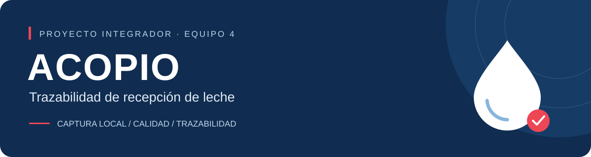

<div align="center">



<br />

**Del registro en campo al seguimiento de cada recepción.**

Aplicación móvil · API compartida · Dashboard de jefatura


<br />


<br />
<br />

[Comenzar](#comenzar) · [Estado](#estado-del-proyecto) · [Equipo](#equipo) · [Guía completa](#guia-completa) · [Informes](#informes)

</div>

---

## El proyecto

Desarrollamos **ACOPIO** para registrar recepciones de leche desde Android, conservarlas en el dispositivo cuando no hay conexión y enviarlas al servidor para evaluar su calidad, consultar su trazabilidad y asignar un tanque de destino.

Nuestro proyecto forma parte del curso **Proyecto Integrador** y toma como contexto el proceso de acopio de **Leche Gloria**. Trabajamos con datos de prueba y umbrales **DEMO-1** para el desarrollo académico; estos valores no representan criterios oficiales de la empresa.

| 01 · Capturar | 02 · Evaluar | 03 · Consultar |
| :--- | :--- | :--- |
| Guardar en SQLite con usuario, centro y UUID. | Enviar manualmente; confirmar y evaluar sin duplicar. | Revisar resultado, QR y destino mediante la API compartida. |

## Estado del proyecto

**Última actualización: 17 de octubre de 2026.**

Hasta esta versión hemos implementado el backend y el recorrido principal de la app móvil. Tenemos la interfaz del dashboard y nos falta conectarla a las APIs para completar la validación conjunta.

| Componente | Estado | Alcance actual |
| :--- | :--- | :--- |
| **Backend** | ✅ Implementado | Login, permisos, recepción, calidad, tanques, reportes y administración |
| **App móvil** | ✅ Implementada | Captura local, sesión, envío manual, calidad, QR y tanques |
| **Dashboard** | 🟡 Integración pendiente | Interfaz incorporada; operación aún con datos ficticios |
| **Aceptación integral** | 🟡 Por completar | Evidencia del mismo lote entre móvil, servidor y web |

> [!IMPORTANT]
> Por ahora, nuestro dashboard utiliza un acceso local y datos de demostración. Ya consulta `/api/estado`; nos falta integrar las demás pantallas con las APIs del backend.

**Últimos resultados que registramos:** 33 pruebas backend y 29 móviles aprobadas. Corresponden a las ejecuciones indicadas en la sección de pruebas; todavía debemos completar la aceptación de todo el recorrido móvil, servidor y web. [Ver evidencias →](#pruebas)

<details>
<summary><strong>Explorar los componentes y carpetas</strong></summary>

| Carpeta | Tecnología / responsabilidad | Estado |
|---|---|---|
| `backend/` | Java 17, Spring Boot 4.1.1, JPA/Hibernate, JWT, Flyway | API real; nueve entidades; 33 pruebas aprobadas en la última verificación |
| `mobile/` | React Native, Expo 57, TypeScript, MVVM, SQLite, SecureStore | Captura local, envío manual, calidad, QR y tanques |
| `dashboard/` | React, Vite, Bootstrap | Interfaz web desarrollada; integración con APIs pendiente |
| `database/` | SQL de referencia del informe | No ejecutar sobre el esquema instalado por Flyway |
| `scripts/` | Preparación y operación Windows | Entorno local con puertos separados |
| `docs/` | Banner e informes PDF/Word | La documentación técnica está en este README |
| `.local/` | Base, secretos, cachés y logs del entorno local | Ignorada por Git; no compartir |

</details>

## Comenzar

### 1. Preparar el entorno

Para trabajar con el proyecto utilizamos Java 17, Maven 3.9+, Node 24 LTS, PostgreSQL 18 y Git. Para la app móvil necesitamos Android con depuración USB autorizada y Expo Go compatible con SDK 57. Preparamos los scripts para Windows; `ACOPIO_PG_BIN` y `ACOPIO_NODE` permiten indicar rutas alternativas.

```powershell
git clone https://github.com/serchiove/milk-traceability-offline.git
cd milk-traceability-offline
powershell -NoProfile -ExecutionPolicy Bypass -File .\scripts\Preparar.ps1
```

Preparamos el entorno una sola vez en cada computadora. Después utilizamos los lanzadores para iniciar los servicios. Los lanzadores usan `.local/db-password.txt` y `.local/jwt-secret.txt`; `.env.example` documenta variables, no se carga automáticamente.

### 2. Arrancar, probar y detener

Ejecutamos los siguientes comandos desde la raíz del repositorio:

```powershell
.\Iniciar.cmd
# En otra terminal, con el celular conectado:
powershell -NoProfile -ExecutionPolicy Bypass -File .\scripts\Conectar-Android.ps1
.\Abrir_Movil.cmd
# Cuando Metro esté listo, pulsar a.
```

| Servicio | Dirección |
|---|---|
| Dashboard | http://127.0.0.1:5173 |
| Diagnóstico API | http://127.0.0.1:18080/api/estado |
| PostgreSQL | 127.0.0.1:55440 · base/usuario acopio_dev |
| Metro | 127.0.0.1:8081 |

Cuando modificamos código Java, ejecutamos `.\Probar_Proyecto.cmd` para recompilar el JAR; `Iniciar.cmd` reutiliza el JAR existente. La compilación también comprueba web y tipos móviles. Ejecutamos las pruebas unitarias móviles por separado:

```powershell
Push-Location mobile
npm test
Pop-Location
```

Al terminar, cerramos Metro con Ctrl+C y ejecutamos `.\Detener.cmd`. Así detenemos los servicios y conservamos los datos. Detalles y solución de errores: [Inicio rápido](#inicio-detallado).

<details>
<summary><strong>Cuentas de demostración y acceso local</strong></summary>

| Uso | Identidad | Clave |
|---|---|---|
| API / app móvil OPERARIO | operario@gloria.com.pe | 123456 |
| API JEFATURA | jefatura@gloria.com.pe | 123456 |
| Dashboard actual de demostración | jefatura.demo | Cualquier texto de prueba; no autentica en backend |

Usamos estas cuentas únicamente para desarrollo. Cada computadora tiene una contraseña privada de PostgreSQL, distinta de las cuentas de la aplicación. Para completar el dashboard reemplazaremos el acceso local por la autenticación JEFATURA descrita en el [contrato compartido](#contrato-compartido).

</details>

## Equipo

Nos organizamos por componentes y colaboramos en su integración. En esta tabla resumimos las entregas que hemos registrado en Git hasta el 20/10/2026:

| Integrante | Trabajo realizado | Referencias |
| :--- | :--- | :--- |
| Sergio | Entorno y esquema inicial; app móvil; integración, ampliaciones backend y migración JPA, con apoyo de Codex durante el desarrollo | `1489916`, `3bf07c9`, `c87f7c1`, `8f559fa` |
| Patricio | Base JWT, DTO, autenticación, recepción, reglas de calidad, repositorios y datos V3 | `17cc591`, `356ac1b` |
| Fernando | Interfaz y estilos del dashboard; aún utiliza datos operativos demo | `570d667`, PR #4 |
| Elías | Datos de prueba alineados, matriz ampliada a 20 casos y ejecución automatizada parcial registrada | `7d40673`, `2bbdf91`, `efb4135`; [matriz](docs/pruebas/MATRIZ_PRUEBAS_ELIAS.md) y [evidencia](docs/pruebas/EJECUCION_AUTOMATIZADA_2026-10-20.md) |

Sergio está a cargo del móvil y la coordinación; Patricio, del backend; Fernando, del dashboard; y Elías, de base de datos y pruebas. Conservamos las referencias de cada entrega porque también hemos colaborado fuera de nuestra parte principal. En el informe de aportes detallamos los cambios por commit, las correcciones y el trabajo que sigue pendiente.

<a id="informes"></a>
## Informes del equipo

| Documento | Uso |
| :--- | :--- |
| [Pendientes de Fernando y Elías](docs/informes/Pendientes_Fernando_Elias.pdf) | Informe temporal de tareas y criterios de cierre; retirar al completar y conservar la evidencia |
| [Incidencias y aportes verificados](docs/informes/Incidencias_y_aportes_verificados.docx) | Registro en Word de problemas, correcciones, implementaciones y aportes reales por commit |

<a id="guia-completa"></a>
## Guía completa

Reunimos en este README la instalación, la arquitectura, los contratos de la API y las pruebas. Organizamos los detalles en apartados desplegables y dejamos los informes del equipo enlazados arriba.

[Inicio detallado y pgAdmin](#inicio-detallado) | [Arquitectura y organización](#arquitectura) | [Estado y alcance pendiente](#alcance) | [Pruebas y evidencias](#pruebas) | [Git y entregas](#github) | [Sesión y acceso móvil](#acceso) | [Correcciones históricas del backend](#historia-backend) | [Catálogos y consultas de lotes](#consultas) | [Tanques y asignación](#tanques) | [Integración móvil](#movil) | [Alineación con el informe oficial](#informe-oficial) | [Administración de catálogos](#administracion) | [Contrato dashboard y móvil](#contrato-compartido) | [Persistencia JPA e Hibernate](#jpa)

<a id="inicio-detallado"></a>
<details>
<summary><strong>Inicio detallado y pgAdmin</strong></summary>

## Arranque en nuestro entorno local

1. Abrimos una sola copia del repositorio y comprobamos su ruta antes de iniciar los servicios. Así evitamos mezclar configuraciones de distintas carpetas.
2. Abrimos `Iniciar.cmd`: inicia PostgreSQL, backend y dashboard.
3. Abrimos http://127.0.0.1:5173 y pulsar «Comprobar API».
4. Para Android, conectar USB con depuración autorizada y ejecutar desde PowerShell en esta carpeta:

```powershell
powershell -NoProfile -ExecutionPolicy Bypass -File .\scripts\Conectar-Android.ps1
```

5. Ejecutamos `Abrir_Movil.cmd`, esperar que Metro esté listo y pulsar `a`.
6. Al terminar, pulsar Ctrl+C en Metro y ejecutar `Detener.cmd`.

| Archivo | Función |
|---|---|
| Iniciar.cmd | Arrancar base, backend y web |
| Abrir_Movil.cmd | Arrancar Expo para Android |
| Verificar.cmd | Consultar estado de servicios |
| Probar_Proyecto.cmd | Compilar backend/web y comprobar tipos del móvil |
| Detener.cmd | Detener los servicios del proyecto |

## Preparación en otra computadora

Instalamos Java 17, Maven 3.9+, Node 24 LTS, PostgreSQL 18 y Git. Para Android usamos Expo Go compatible con SDK 57 y depuración USB, o un emulador con ADB.

Después de clonar o descomprimir el proyecto, ejecutamos:

```powershell
powershell -NoProfile -ExecutionPolicy Bypass -File .\scripts\Preparar.ps1
```

Luego seguimos los pasos de arranque. Cada computadora genera su propia base y contraseña; el paquete no incluye datos privados ni dependencias instaladas.
Los scripts buscan PostgreSQL en `C:\Program Files\PostgreSQL\18\bin`; usar `ACOPIO_PG_BIN` para otra ruta y `ACOPIO_NODE` para especificar Node.

## Puertos y errores

- Web: 5173. API: 18080. PostgreSQL: 55440. Metro: 8081.
- Diagnóstico: http://127.0.0.1:18080/api/estado.
- Logs locales: `.local/backend.log`, `.local/backend.error.log`, `.local/postgres.log`.
- Falta contraseña: preparar primero el entorno; no inventar un archivo de contraseña.
- Android no conecta: confirmar `adb devices`, volver a ejecutar Conectar-Android y mantener Metro abierto.
- No eliminar `.local/pgdata` ni ejecutar de nuevo el SQL del informe para reparar un error.
- `.env.example` es una referencia: los lanzadores usan la contraseña privada de `.local`, no cargan automáticamente ese archivo.


## Conectar PostgreSQL a pgAdmin

Creamos la base en PostgreSQL mediante los scripts del proyecto. Usamos pgAdmin para administrarla y consultar los registros. Al registrar la conexión accedemos a esa instancia, sin crear otra base.

1. Ejecutamos Iniciar.cmd en la carpeta del proyecto y esperar a que los servicios estén disponibles.
2. Abrimos pgAdmin. Hacer clic derecho en Servers, seleccionar Register y después Server.
3. En General, escribir Acopio Desarrollo como nombre.
4. En Connection, completar estos valores:

| Campo | Valor |
|---|---|
| Host name o address | 127.0.0.1 |
| Port | 55440 |
| Maintenance database | acopio_dev |
| Username | acopio_dev |
| Password | Contenido del archivo .local/db-password.txt de esta computadora |

5. Abrimos el archivo de contraseña local y copiar su contenido sin espacios ni saltos de línea adicionales. No compartir esa contraseña ni incluirla en capturas, informes o GitHub. Cada computadora genera la suya.
6. Pulsamos Save. Desplegar Servers → Acopio Desarrollo → Databases → acopio_dev → Schemas → acopio → Tables. Si es necesario, hacer clic derecho y seleccionar Refresh.
7. Deben aparecer nueve tablas: rol, centro_acopio, usuario, proveedor, vehiculo, tanque, lote_leche, registro_calidad e incidencia. Las tablas del proyecto están en acopio; public contiene el historial de migraciones de Flyway.

Si aparece connection timeout expired, confirmar que Iniciar.cmd terminó, revisar host 127.0.0.1 y puerto 55440 y ejecutar Verificar.cmd. Si continúa, revisar .local/postgres.log. Ese mensaje indica que no se alcanza el servidor; no exige recrear las tablas. Si aparece un error de autenticación, revisar usuario y contraseña local.
Al ejecutar Detener.cmd se detiene también esta instancia de PostgreSQL; para volver a conectarse desde pgAdmin, ejecutar Iniciar.cmd nuevamente. No confundir esta instancia con otros servidores de PostgreSQL que usen el puerto 5432.

[Volver al índice](#guia-completa)

</details>

<a id="arquitectura"></a>
<details>
<summary><strong>Arquitectura y organización</strong></summary>

## Cómo conectamos los componentes

Organizamos el sistema con este flujo:

**Móvil (React Native / TypeScript / MVVM) → API REST Spring Boot → JPA/Hibernate → PostgreSQL.**

En el teléfono conservamos borradores y catálogos en SQLite, y la sesión en SecureStore. Para la web utilizamos React y el perfil JEFATURA. Compartimos la API entre ambos clientes, aunque todavía tenemos pendiente conectar las pantallas operativas del dashboard.

## Carpetas

| Ruta | Responsabilidad |
|---|---|
| mobile/src/view | Pantallas |
| mobile/src/viewmodel | Acciones y estado de pantalla |
| mobile/src/model | Datos y repositorio SQLite |
| mobile/src/services | Acceso HTTP, sesión, huella y envío |
| mobile/src/navigation | Recorrido del operario |
| backend/.../controller | Contratos HTTP y validación de entrada |
| backend/.../service | Negocio y límites transaccionales |
| backend/.../repository | EntityManager, consultas JPQL y bloqueos |
| backend/.../model | Nueve entidades JPA y sus relaciones |
| backend/.../DTO | Datos de entrada/salida; no exponer entidades |
| backend/.../security | JWT, identidad y permisos |
| backend/.../calidad | Motor y reglas DEMO-1 |
| backend/src/main/resources/db/migration | Fuente oficial del esquema, Flyway V1–V4 |
| dashboard/src | Vistas web; main.jsx concentra actualmente las pantallas |
| database | SQL del informe como referencia, no instalador adicional |

`backend/...` abrevia `backend/src/main/java/pe/edu/utp/acopio`.

## Decisiones que tomamos

- El móvil guarda responsable, centro y solicitud antes del envío; confirma únicamente después de respuesta válida. La sincronización es manual.
- El servidor obtiene usuario y centro del JWT, verifica el estado actual y mantiene el aislamiento de consultas.
- UUID y SHA-256 permiten reintentar sin duplicar. Recepción y evaluación son transaccionales.
- Asignación: bloquear lote y luego tanque; el trigger reserva capacidad una vez. No hay vaciado, mezcla ni reasignación.
- Hibernate usa `ddl-auto=validate`, nunca crea o altera tablas; Flyway administra el esquema.
- Los catálogos de proveedores/vehículos son globales; los lotes y tanques pertenecen a un centro.
- No existe acceso directo del móvil o navegador a PostgreSQL.

Detalles: [JPA/Hibernate](#jpa) y [contrato compartido](#contrato-compartido).

[Volver al índice](#guia-completa)

</details>

<a id="alcance"></a>
<details>
<summary><strong>Estado y alcance pendiente</strong></summary>

Al 17/10/2026 tenemos implementadas las funciones que marcamos a continuación. La aceptación conjunta sigue pendiente en los casos que indicamos más abajo.

## Lo que ya implementamos

- [x] Backend: login BCrypt/JWT, permisos y validación por cuenta/centro.
- [x] Catálogos, recepción, huella, idempotencia y rollback.
- [x] Calidad DEMO-1, motivos, incidencia y contenido QR.
- [x] Consulta y asignación de tanques con capacidad y concurrencia.
- [x] Reportes JSON/CSV, indicadores y CORS.
- [x] Administración de proveedores y vehículos por JEFATURA.
- [x] Nueve entidades JPA/Hibernate; esquema administrado por Flyway.
- [x] App móvil: captura SQLite, sesión autorizada, envío manual y consultas centrales.
- [x] Interfaz del dashboard de Fernando incorporada a Git.

## Lo que nos falta para cerrar la integración

- [ ] Fernando: sustituir login y datos ficticios por APIs reales.
- [ ] Elías: corregir y ejecutar su matriz, completar resultado/evidencia.
- [ ] Equipo: aceptar un mismo lote móvil → PostgreSQL → dashboard con calidad, QR, tanque y CSV.
- [ ] Sergio/Elías: evidenciar offline, cierre/reapertura, reintento, sesión vencida y cámara.
- [ ] Patricio/Elías: documentar una instalación limpia y una actualización sin pérdida de datos.

El detalle operativo está en el [informe temporal](docs/informes/Pendientes_Fernando_Elias.pdf). Completaremos estos pasos con resultados y evidencias propios, además de las pruebas automatizadas.

## Mejoras que dejamos para una siguiente etapa

Tenemos pendientes la auditoría completa, la renovación y recuperación de acceso, la limitación de intentos, la sincronización automática, una cuenta de BD con privilegios mínimos, HTTPS, backups/restauración y mediciones de rendimiento. Mezclas, vaciados, trasvases y producción completa quedan fuera del alcance descrito en el informe oficial.

[Volver al índice](#guia-completa)

</details>

<a id="pruebas"></a>
<details>
<summary><strong>Pruebas y evidencias</strong></summary>

## Resultados que hemos registrado

| Fecha | Alcance | Resultado registrado |
|---|---|---|
| 20/10/2026 | Revisión de Elías sobre `a59788d` | 29/29 pruebas móviles y typecheck aprobados; dashboard compilado; backend bloqueado en ese entorno y no atribuido como ejecución propia |
| 17/10/2026 | Backend migrado a JPA, HTTP + PostgreSQL aislado | 33 pruebas aprobadas, JAR generado |
| 17/10/2026 | Suite móvil | 29 pruebas aprobadas; almacenamiento SQLite en memoria y HTTP simulado |
| 16/10/2026 | TypeScript y exportación Android | Correctos en la revisión de integración; no equivale a APK distribuible |
| 16/10/2026 | Android conectado | Calidad y tanque TQ-01 consultados desde el teléfono; no se confirmó asignación en esa comprobación |
| 17/10/2026 | Rama Elías efb4135 | 15 casos preparados; resultados/evidencias figuran pendientes |

La revisión actual de Elías se encuentra en la [matriz de 20 casos](docs/pruebas/MATRIZ_PRUEBAS_ELIAS.md), los [datos de prueba alineados](docs/pruebas/DATOS_FICTICIOS_ELIAS.md) y la [evidencia del 20/10/2026](docs/pruebas/EJECUCION_AUTOMATIZADA_2026-10-20.md).

Conservamos las fechas y el alcance de cada ejecución para distinguir lo que probamos de lo que todavía debemos validar. Las pruebas están en `backend/src/test` y `mobile/tests`; completamos su seguimiento con los logs locales y la [bitácora de incidencias](docs/informes/Incidencias_y_aportes_verificados.docx). Antes de compartir evidencia retiramos los datos sensibles.

## Ejecución automatizada

Desde la raíz, `.\Probar_Proyecto.cmd` prepara PostgreSQL de pruebas, ejecuta Maven verify, compila el dashboard y comprueba tipos móviles. Usa `acopio_test`, no los lotes de `acopio_dev`. Puede reiniciar el backend local para reemplazar el JAR.

Para completar las comprobaciones, ejecutamos también la suite móvil:

```powershell
Push-Location mobile
npm test
Pop-Location
```

Cuando una fase falla, revisamos el primer error y registramos el resultado obtenido antes de continuar con la validación.

## Nuestro recorrido de aceptación manual

1. Registramos versión/commit, fecha, PC y dispositivo; usar datos ficticios.
2. Iniciamos servicios y entrar como OPERARIO en el móvil.
3. Creamos lote con 100 L, 4 °C, 16 °D, 1,0300 g/mL. Guardar, enviar y registrar UUID.
4. Verificamos APROBADO y QR con DEMO-1. Un dato bien formado fuera del rango produce RECHAZADO conservado, no HTTP 400 por calidad.
5. Asignar un tanque disponible del mismo centro, verificar incremento único y reconsulta sin duplicación.
6. Probamos rechazo, falta de capacidad, centro ajeno y rol no autorizado.
7. Tras conectar el dashboard, consultar el mismo UUID como JEFATURA y contrastar litros, estado, destino, indicadores y CSV con PostgreSQL.
8. Probamos captura sin backend manteniendo Metro disponible por USB; cerrar/reabrir y enviar al recuperar conexión. No confundir caída de Metro con modo offline de negocio.
9. Probamos escaneo QR, permiso denegado e ingreso manual; sesión vencida y entrada inválida.
10. Completamos la [plantilla](#entrega) con obtenido y evidencia. No marcar aprobado por inferencia.

## Consultas de comprobación en pgAdmin

```sql
SELECT * FROM acopio.lote_leche ORDER BY recibido_en DESC LIMIT 10;
SELECT * FROM acopio.registro_calidad ORDER BY fecha_evaluacion DESC NULLS LAST LIMIT 10;
SELECT * FROM acopio.tanque;
```

No insertar ni borrar lotes de presentación para probar casos destructivos. El error de la consulta antigua con `registro_calidad.fecha_hora` se corrigió: la columna real es `fecha_evaluacion`.

[Volver al índice](#guia-completa)

</details>

<a id="github"></a>
<details>
<summary><strong>Git y entregas</strong></summary>

Repositorio: https://github.com/serchiove/milk-traceability-offline
Rama principal: main.

## Obtener el proyecto en otra computadora

```powershell
git clone https://github.com/serchiove/milk-traceability-offline.git
cd milk-traceability-offline
powershell -NoProfile -ExecutionPolicy Bypass -File .\scripts\Preparar.ps1
```

Preparar.ps1 requiere Java 17, Maven 3.9+, Node 24 LTS, Git y PostgreSQL 18 instalados. Ver la sección Inicio detallado y pgAdmin.

## Trabajar en una función nueva

Antes de iniciar una función, guardamos nuestros cambios y partimos de un árbol de trabajo limpio:

```powershell
git switch main
git pull --ff-only origin main
git switch -c feature/login-movil
```

Elegimos el nombre de la rama según la función. Revisamos `git diff`, ejecutamos las comprobaciones correspondientes y agregamos los archivos de la entrega al commit. Publicamos la rama y abrimos un PR para revisar los cambios antes de integrarlos en `main`.
Cada integrante utiliza su propia cuenta de GitHub. Trabajamos mediante ramas y PR, sin force push sobre `main` ni credenciales compartidas.

## Qué se publica

Publicamos el código fuente, los archivos lock, las migraciones, los lanzadores y la documentación. Excluimos `.local`, contraseñas, archivos de entorno privados, dependencias instaladas y compilaciones. Las variables de ejemplo no contienen la contraseña real.
La carpeta del repositorio en GitHub es directamente la raíz del proyecto: backend, mobile y dashboard no están dentro de otra carpeta acopio-app.

[Volver al índice](#guia-completa)

</details>

<a id="acceso"></a>
<details>
<summary><strong>Sesión y acceso móvil</strong></summary>

## Autenticación que utilizamos

`POST /api/auth/login`, con JSON `email` y `password`.
Consulta `acopio.usuario`, `acopio.rol` y `acopio.centro_acopio`. Comprueba BCrypt, usuario activo y centro activo. Una contraseña incorrecta, usuario inexistente o cuenta/centro inactivo devuelve 401 sin distinguir cuál falló.

Respuesta 200 compatible con `mobile/src/services/authService.ts`:

```json
{
  "accessToken": "TOKEN_GENERADO_POR_EL_BACKEND",
  "usuario": {
    "id": 1,
    "nombre": "Nombre del operario",
    "rol": "OPERARIO",
    "idCentro": 1,
    "centro": "Centro asignado"
  }
}
```

Los IDs son ejemplos; se obtienen de la base. El backend admite cuentas de OPERARIO y JEFATURA; la app móvil acepta únicamente OPERARIO.

## Estado de la app

Conectamos el acceso móvil a `/api/auth/login`. La dirección base se configura con `EXPO_PUBLIC_API_URL`. Perfil → Catálogos consulta proveedores, vehículos y centro con el token de la sesión. El token se conserva en Expo SecureStore hasta la expiración del JWT y la contraseña se limpia después del intento. La sesión vigente se restaura al reiniciar si existen los catálogos locales. Véase [alineación con el informe](#informe-oficial).

Las nuevas capturas y ediciones SQLite se asocian al usuario y centro autorizados y usan IDs de catálogo. Los registros antiguos sin responsable requieren vinculación explícita antes del envío. El acceso no envía automáticamente los borradores; la sincronización disponible es manual.

## Autorización

`POST /api/lotes` requiere `Authorization: Bearer TOKEN` y rol OPERARIO. Los IDs de usuario y centro se toman de la identidad autenticada, no del JSON enviado por el móvil. Cada petición con token comprueba que la cuenta y centro sigan activos y que no hayan cambiado rol o centro respecto del token.

401 indica autenticación ausente, inválida, vencida o invalidada por cambio de cuenta; 403 indica que el rol autenticado no permite esa operación. El backend no implementa todavía limitación de intentos/429 ni recuperación de contraseña.

## Cómo configuramos la sesión

`JWT_SECRET` es obligatorio y debe tener al menos 32 bytes. `scripts/Dev.ps1` genera una clave aleatoria por PC en `.local/jwt-secret.txt` cuando no se suministra por entorno. No debe publicarse ese archivo. `JWT_EXPIRATION_MS` es configurable y vale 86400000 por defecto. Al cambiar la clave se invalidan los tokens anteriores.

Antes de desplegar configuraremos HTTPS y credenciales propias. Reservamos las cuentas de V3/V4 para demostración.

[Volver al índice](#guia-completa)

</details>

<a id="historia-backend"></a>
<details>
<summary><strong>Correcciones históricas del backend</strong></summary>

En la entrega del 16/10/2026 corregimos el acceso y la recepción para conectarlos con el móvil. Conservamos aquí los cambios y resultados de esa etapa. Después ampliamos las funciones y migramos la persistencia a [JPA/Hibernate](#jpa); el alcance actual se detalla en la [alineación con el informe](#informe-oficial).

## Cambios que incorporamos

- Consultas de autenticación con esquema `acopio`, nombre del centro y comprobación de centro activo.
- Login compatible con la estructura esperada por el móvil: `accessToken` y `usuario` con `id`, `idCentro`, `nombre`, `centro`, `rol`.
- Identidad autenticada tipada en el controlador. No se vuelve a cortar ni interpretar manualmente el encabezado Authorization.
- Recepción reservada a OPERARIO; endpoints no implementados denegados por defecto.
- Tokens contrastados con estado actual de cuenta, rol y centro. Respuestas 401/403 JSON.
- Clave JWT externa; generación local de una clave aleatoria fuera de Git mediante Dev.ps1. Debe dejar de utilizarse la antigua clave publicada.
- Validación de IDs positivos, precisión decimal y límites numéricos del modelo antes de persistir. Una medición válida fuera de los rangos de calidad conserva un lote rechazado, no se elimina.
- Referencias activas exigidas para nuevas recepciones. Reenvíos idénticos históricos siguen confirmándose sin duplicados aunque luego se desactive un catálogo.
- Errores de datos/referencias devuelven 400 sin mensajes internos SQL; UUID con contenido diferente devuelve 409.
- SHA-256 normalizado en el servidor. Después incorporamos el cálculo en el móvil y la verificación en el servidor; el formato vigente está en [Contrato de la huella](#informe-oficial).
- Rangos configurables por entorno (`CALIDAD_TEMPERATURA_MIN/MAX`, `CALIDAD_ACIDEZ_MIN/MAX`, `CALIDAD_DENSIDAD_MIN/MAX`) y versión `CALIDAD_VERSION`.
- La versión predeterminada es DEMO-1. Los rangos son de desarrollo, no una afirmación de cumplimiento de una NTP ni criterios oficiales de Gloria. Cualquier cambio de rangos debe acompañarse de una versión nueva. No se reevalúan lotes finalizados.
- V4 corrige el hash incorrecto de las dos cuentas de desarrollo de V3, únicamente si conservan ese hash. V1, V2 y V3 no se modifican. Contraseña ficticia de esas cuentas: `123456`; no usar fuera de desarrollo.

## Recepción

`POST /api/lotes`, con token de operario:

```json
{
  "idLote": "550e8400-e29b-41d4-a716-446655440004",
  "idProveedor": 1,
  "idVehiculo": 1,
  "volumenLitros": 120.50,
  "fechaHora": "2026-10-16T08:30:00-05:00",
  "mediciones": {
    "temperaturaC": 4.5,
    "acidezDornic": 16,
    "densidadGml": 1.0300
  }
}
```

En este ejemplo omitimos la huella, como permitía el contrato inicial. Nuestro móvil actual sí envía `huellaSolicitud` y el servidor la verifica; mantenemos el campo opcional para clientes anteriores. Obtenemos los IDs de catálogos activos y conservamos UUID, fecha y contenido en cada reintento. El servidor determina usuario y centro a partir del JWT.

Respuesta: 201 para nuevo lote, 200 con `idempotente=true` para reintento idéntico, 409 para UUID reutilizado con contenido distinto. Incluye estadoEvaluacion, versionReglas, motivo, codigoQr, huellaSolicitud y fechas. Lote y mediciones se escriben en una transacción; los triggers existentes generan QR o incidencia al finalizar la evaluación.

## Cómo lo verificamos

En esa etapa ejecutamos `mvn verify` y obtuvimos 13 pruebas aprobadas y el JAR generado.
La prueba de flujo usa HTTP real, Spring Security y PostgreSQL en `acopio_revision_20261016`, separada de `acopio_dev`.
Cubre login y contrato, credenciales incorrectas, cuenta/centro inactivos, roles, tokens inválidos/vencidos, aprobación, rechazo, incidencia única, idempotencia, conflicto, referencias inactivas, precisión, rollback y solicitudes concurrentes.

`Probar_Proyecto.cmd` prepara `acopio_test` para pruebas; la configuración de test usa `TEST_DB_NAME` (por defecto acopio_test), independientemente de DB_NAME. Para ejecutar Maven directamente debe existir la base de pruebas y definirse DB_PASSWORD.

Ejecutamos esas pruebas sobre una base aislada. Flyway aplica las migraciones pendientes al iniciar cada entorno de desarrollo. Integramos estas correcciones y las ampliaciones posteriores en `c87f7c1` (PR #5).

## Ampliaciones posteriores

La ampliación de catálogos y consulta central de lotes se encuentra documentada en [Catálogos y consultas de lotes](#consultas). La asignación de tanques está documentada en [Tanques y asignación](#tanques). Indicadores/reportes y envío manual móvil ya están implementados; ver [Alineación con el informe oficial](#informe-oficial). El móvil no envía borradores automáticamente. Administración de proveedores y vehículos: [Administración de catálogos](#administracion).

[Volver al índice](#guia-completa)

</details>

<a id="consultas"></a>
<details>
<summary><strong>Catálogos y consultas de lotes</strong></summary>

Incorporamos estas consultas el 16 de octubre de 2026 para complementar el login y la recepción con `POST /api/lotes`.

## Autenticación y alcance

Todas las rutas de esta sección requieren `Authorization: Bearer TOKEN` y rol OPERARIO o JEFATURA. POST /api/lotes sigue reservado a OPERARIO.

El centro se toma de la identidad autenticada. No existe un filtro para consultar centros ajenos: enviar `idCentro` en la URL no cambia el alcance. Tanto operario como jefatura pueden consultar las recepciones de su centro, incluidas las de otros operarios de ese mismo centro.

Proveedores y vehículos son catálogos globales en el modelo actual; no tienen asociación a un centro. Se exponen únicamente registros activos. La vigencia documental del proveedor se informa en `estadoCert`, no se presenta como certificación oficial.

## Rutas

| Método y ruta | Resultado |
|---|---|
| GET /api/catalogos/proveedores | Proveedores activos: id, tipoDocumento, numeroDocumento, razonSocial, estadoCert. |
| GET /api/catalogos/vehiculos | Vehículos activos: id, placa, capacidadLitros. |
| GET /api/catalogos/centro | Centro activo asignado al usuario: id, nombre, region, capacidadLitros. |
| GET /api/lotes | Recepciones del centro del usuario con filtros y paginación. |
| GET /api/lotes/{idLote} | Detalle de una recepción por UUID. |
| GET /api/lotes/por-qr?codigo=ACOPIO:UUID | Detalle del lote cuyo código QR fue realmente asignado. |

La consulta por QR resuelve el contenido del código: no genera una imagen ni activa la cámara. Un lote rechazado, sin QR asignado, no se puede consultar por un código inventado; sí puede consultarse por su UUID autorizado.

## Paginación

Proveedores, vehículos y lotes aceptan `pagina` (desde 0) y `tamano` (1 a 100, predeterminado 25). Página máxima: 1000000. Una página fuera de los resultados devuelve elementos vacíos, conservando el total.

```json
{"elementos": [], "total": 0, "pagina": 0, "tamano": 25}
```

La búsqueda `buscar` acepta hasta 180 caracteres y no distingue mayúsculas. En proveedores busca razón social/documento; en vehículos, placa; en lotes, proveedor/placa/UUID. Es texto literal, no un patrón SQL. No se implementa normalización de tildes.

Orden estable: nombre e ID para proveedores, placa e ID para vehículos, fecha descendente y UUID descendente para lotes.

## Filtros de lotes

- `estado`: PENDIENTE, APROBADO o RECHAZADO; si se omite incluye todos.
- `desde` y `hasta`: fechas ISO YYYY-MM-DD, ambas inclusivas. Se filtra la fecha de captura (`fecha_hora`), no la de recepción central.
- Los días se interpretan en America/Lima, configurable mediante `app.consultas.zona`.
- Pueden combinarse estado, fechas, texto y paginación.

Ejemplo:

```text
GET /api/lotes?estado=APROBADO&desde=2026-10-01&hasta=2026-10-16&pagina=0&tamano=25
```

El detalle incluye IDs y nombres de origen, operario y centro; fecha de captura/recepción; volumen, temperatura, acidez y densidad; estado, motivo, versión y fecha de evaluación; código QR; tanque y fecha de asignación cuando existan. No expone contraseñas, tokens ni huella de la petición.

## Errores

- 400: filtros, paginación, fechas o UUID inválidos; QR mal formado o parámetro requerido ausente.
- 401: sin autenticación válida, cuenta/centro inactivos o token revocado/vencido.
- 403: rol sin autorización.
- 404: recurso inexistente o perteneciente a otro centro; no distingue ambos casos.

## Cómo lo verificamos

En la entrega de consultas ejecutamos `mvn verify`: obtuvimos 19 pruebas sin fallos y generamos el JAR. Las pruebas utilizan HTTP real y PostgreSQL en la base aislada acopio_revision_20261016. Comprobamos autenticación, catálogos activos, aislamiento por centro, consulta por UUID/QR, paginación, fechas en límites de día, validación de filtros y los flujos anteriores de recepción/idempotencia/rollback.

Esta ampliación no modificó migraciones ni registros de acopio_dev. Posteriormente se integraron las consultas al móvil y se implementaron tanques, indicadores, incidencias y reportes. Estado actualizado en [Alineación con el informe oficial](#informe-oficial); administración de proveedores y vehículos en [Administración de catálogos](#administracion). Nos queda completar el consumo de estas APIs desde el dashboard.

[Volver al índice](#guia-completa)

</details>

<a id="tanques"></a>
<details>
<summary><strong>Tanques y asignación</strong></summary>

Implementamos la consulta y asignación de tanques el 16 de octubre de 2026. Reutilizamos las tablas y los triggers del modelo original, sin añadir migraciones para esta entrega.

## Consulta

`GET /api/tanques` requiere token de OPERARIO o JEFATURA. Devuelve únicamente tanques del centro autenticado.

Parámetros: `pagina` (0 por defecto), `tamano` (25 por defecto, máximo 100), `disponibles` (false por defecto). `disponibles=true` devuelve únicamente tanques con estado DISPONIBLE y saldo positivo; el saldo debe compararse con el volumen del lote antes de elegirlo. La asignación vuelve a comprobarlo dentro de la transacción.

Formato paginado: elementos, total, pagina y tamano. Cada tanque contiene id, codigo, estado, capacidadLitros, volumenAsignadoLitros y disponibleLitros.

El volumen asignado es la reserva controlada por la base, no una medición física ni una lectura de sensores. El listado puede cambiar al producirse otras asignaciones.

## Asignación

`POST /api/lotes/{UUID}/asignacion-tanque`, con token de OPERARIO y cuerpo:

```json
{"idTanque": 1}
```

El ID es ilustrativo. El servidor toma el usuario y el centro del token. Requiere lote APROBADO, tanque del mismo centro, estado DISPONIBLE y saldo suficiente. No hay asignación parcial: un lote tiene un solo tanque.

Respuesta 201 para la primera asignación; 200 con idempotente=true para un reintento al mismo tanque. Incluye idLote, idTanque, codigo, volumenLitros, asignadoEn e idUsuarioAsigna. El reintento no cambia la fecha, responsable ni volumen reservado del registro original, aunque posteriormente el tanque esté lleno o en mantenimiento.

Errores:

- 400: cuerpo/UUID/ID inválido o paginación incorrecta.
- 401: autenticación ausente, inválida o vencida.
- 403: rol sin permiso; JEFATURA puede consultar pero no asignar.
- 404: lote o tanque inexistente o de otro centro.
- 409: lote sin aprobación, tanque no disponible, capacidad insuficiente o intento de reasignar a otro tanque.

## Concurrencia y trazabilidad

El servicio bloquea primero la fila del lote y después la del tanque, siempre en ese orden. La transacción conserva ambas hasta confirmar o revertir. El trigger original reserva el volumen; el servicio no incrementa el contador por separado. Esto evita doble reserva en reintentos y sobreasignación cuando llegan solicitudes simultáneas.

Por ahora no contemplamos reasignaciones, vaciados, mezclas ni trasvases. La consulta de detalle del lote refleja el tanque y la fecha de asignación.

## Cómo lo verificamos

En la entrega de tanques ejecutamos `mvn verify` sobre una base PostgreSQL aislada: obtuvimos 24 pruebas aprobadas y generamos el JAR. Incluye asignación válida, reintentos, lotes rechazados, mantenimiento, capacidad insuficiente, aislamiento entre centros, permisos y dos asignaciones concurrentes que compiten por capacidad insuficiente para ambas.

Actualización: las pantallas móviles de calidad y tanques ya consumen estas rutas. Los indicadores, incidencias y reportes del backend también están implementados; consultar [Alineación con el informe oficial](#informe-oficial). Nos falta completar la integración de estas consultas en la web.

[Volver al índice](#guia-completa)

</details>

<a id="movil"></a>
<details>
<summary><strong>Integración móvil</strong></summary>

Nuestro recorrido completo y su relación con los casos de uso están en [Alineación con el informe oficial](#informe-oficial).

El acceso usa POST /api/auth/login, los catálogos se descargan a SQLite y la sesión se conserva en SecureStore hasta su vencimiento. La captura ya selecciona IDs oficiales y guarda responsable/centro en la misma transacción del lote. No hay captura nueva anónima.

Desde el detalle se envía manualmente conservando UUID, contenido y huella SHA-256. Perfil incluye consulta central de calidad, lectura/generación visual de QR y asignación de tanques. Preparamos también reportes CSV e indicadores en el backend para integrarlos con el dashboard de jefatura.

EXPO_PUBLIC_API_URL configura el backend; por USB, scripts/Conectar-Android.ps1 redirige el puerto 18080 y el puerto 8081 de Expo. Reiniciar Expo después de instalar dependencias o cambiar variables. El backend debe recompilarse para exponer las rutas nuevas.

[Volver al índice](#guia-completa)

</details>

<a id="informe-oficial"></a>
<details>
<summary><strong>Alineación con el informe oficial</strong></summary>

Tomamos como referencia nuestro informe **INTEGRADOR AVANCE 2 FINAL (1).pdf**, de 96 páginas. La siguiente correspondencia recoge la implementación revisada el 16/10/2026.

## Relación con nuestros casos de uso

- CU-01 (pp. 44–45): captura móvil con sesión autorizada, catálogos descargados, UUID, fecha y responsable. La app descarga proveedores, vehículos y centro al iniciar sesión. La edición se aísla por usuario y centro. Guardar confirma en una transacción SQLite el lote y su solicitud de envío, incluyendo sus IDs oficiales y responsable.
- CU-02 (pp. 45–46): envío manual con UUID y huella SHA-256, conservación ante fallos e idempotencia. La huella se calcula en el móvil; Java la recalcula y verifica. El campo es opcional en la API para compatibilidad con clientes antiguos. La respuesta del servidor distingue recepción de aprobación.
- CU-03 (pp. 47–48): Perfil → Tanques de destino muestra lotes aprobados. El operario consulta tanques de su centro y confirma uno. El servidor valida disponibilidad y capacidad y reserva volumen transaccionalmente. La app consulta la asignación actual antes de repetir; un error no se presenta como éxito. Dejamos fuera de este alcance la mezcla, el vaciado, el trasvase y la reasignación.
- CU-04 (pp. 48–49): Perfil → Resultados de calidad o Buscar por identificador permite consultar información central, mediciones, estado, motivo, QR y destino. La cámara lee QR; si no se autoriza o no es legible, queda disponible el ingreso manual de UUID o ACOPIO:UUID.
- CU-05 (p. 50): el backend expone indicadores e incidencias para JEFATURA mediante /api/reportes y ocupación mediante /api/tanques. Tenemos pendiente conectar las pantallas del dashboard a estas rutas.
- CU-06 (pp. 51–52): API JSON para vista previa filtrada por periodo de captura, estado y búsqueda de proveedor/placa/UUID; API CSV para exportación desde PostgreSQL. Hasta 10 000 registros por consulta; se exige acotar el periodo si se supera. El centro se restringe al autorizado en la cuenta; el esquema actual no tiene autorización multicentro.
- QR (p. 74): PostgreSQL conserva el contenido ACOPIO:UUID, exclusivamente para aprobados. La app genera la matriz visual, con margen blanco, usando qrcode-generator. No se almacena una imagen binaria en PostgreSQL.

## Sesión y operación offline

Necesitamos conexión para el primer inicio de sesión. Guardamos el token y los datos de sesión en Expo SecureStore, sin almacenar la contraseña. La vigencia offline termina en la expiración del JWT (configuración backend predeterminada: 24 horas). Cerrar sesión elimina el acceso guardado; mantiene los lotes y ediciones. La revocación en el servidor se detecta al comunicarse; no puede comprobarse mientras el equipo está desconectado.

Los catálogos descargados viven en SQLite, asociados a usuario y centro. Se actualizan con cada inicio de sesión online. El servidor vuelve a validar las referencias al recibir. Todavía no implementamos renovación de token ni sincronización automática en segundo plano. La sincronización disponible es manual desde el detalle.

Conservamos los lotes antiguos. Los que no tenían responsable oficial requieren vinculación explícita antes del envío; no se adivinan IDs por nombres. La edición antigua sin responsable se conserva en su tabla original, sin importarla automáticamente a una cuenta. Las nuevas ediciones están separadas por operario/centro.

## Contrato de la huella

UTF-8 → SHA-256 hexadecimal minúsculo de:

UUID|idProveedor|idVehiculo|idUsuario|idCentro|instanteUTC|volumen|temperatura|acidez|densidad

Números sin ceros decimales finales. Fecha UTC compatible con java.time.Instant; milisegundos cero se omiten. Los valores de usuario y centro vienen de la sesión autenticada y el backend vuelve a determinarlos. La solicitud guardada no cambia tras un intento, aunque no haya confirmación HTTP.

## Indicadores y CSV

GET /api/reportes y GET /api/reportes/csv: solo JEFATURA. Filtros desde/hasta inclusivos en America/Lima sobre fecha de captura, estado y buscar. Lectura consistente de PostgreSQL para cada consulta. El CSV vuelve a consultar con los filtros de la vista previa: puede incluir cambios confirmados después de esa vista. Incluye identificación, responsable, procedencia, mediciones, resultado, motivo, reglas, tanque y contenido QR. Escapa comillas/saltos de línea y neutraliza fórmulas en campos textuales.

Volumen = suma de litros de los lotes filtrados. Aprobación = aprobados / total de lotes filtrados. Incidencias = lotes distintos con al menos una incidencia / total filtrado. Sin resultados, indicadores cero. El listado de incidencias proviene de incidencia y registro_calidad; no se simula a partir de mensajes de pantalla. La ocupación mostrada corresponde al presente, no a una reconstrucción histórica por fecha.

## Decisiones y límites frente al informe

Los umbrales DEMO-1 siguen siendo demostrativos, como advierte el informe (p. 9). No equivalen a criterios oficiales de Gloria. El esquema de nueve tablas no incluye auditoría detallada RF-14; el informe la identifica como mejora futura (pp. 53 y 75). El entorno USB utiliza HTTP local de desarrollo; el despliegue integrado debe configurar HTTPS. Rendimiento <2 segundos, dispositivos reales y concurrencia de producción requieren medición dedicada; compilar no acredita esos requisitos.

## Recorrido que usamos para la aceptación

1. Reiniciamos backend recompilado y Expo. Mantener PostgreSQL y los registros existentes; no reinstalar ni borrar los datos de la app.
2. Iniciamos sesión móvil con operario@gloria.com.pe / 123456 (solo datos ficticios de desarrollo). Esperar la descarga de catálogos.
3. Creamos una recepción seleccionando proveedor/vehículo oficiales. Guardar 100 L, 4 °C, 16 °D, 1,0300 g/mL. Enviar desde el detalle. Debe confirmarse y aprobarse con DEMO-1.
4. Entramos a Perfil → Resultados de calidad: consultar el lote y comprobar los datos reales, reglas y QR.
5. En Tanques de destino abrir el aprobado, seleccionar uno con capacidad y confirmar. Actualizar y comprobar que conserva el destino; reconsultar no incrementa de nuevo la ocupación.
6. Probamos un rechazo: debe conservarse y mostrar el motivo, sin QR ni acción de asignación.
7. Mostramos un QR en otro dispositivo y escanearlo, autorizando la cámara. Probar también el UUID manual y un identificador inexistente.
8. Para probar offline, mantener Expo accesible (por USB) y detener solo el backend o interrumpir su acceso. Mantener sesión vigente, guardar un lote y cerrar/reabrir la app. Debe conservarse. Al volver el backend, enviar el mismo registro. No desconectar Metro si se usa Expo Go: es el servidor de desarrollo, distinto del backend.
9. Con una sesión JEFATURA, probar GET /api/reportes y GET /api/reportes/csv con los mismos filtros. Comparar con PostgreSQL. Cuando completemos la integración web, repetiremos la comparación desde sus pantallas.
10. Probamos sesión vencida y cuenta de otro centro: no deben enviar ni consultar datos ajenos. Los datos locales nuevos de otro operario no aparecen en el historial de la cuenta actual.

Comprobamos la cámara y la presentación en el teléfono mediante pruebas manuales. Las pruebas automatizadas de móvil usan SQLite real en memoria y respuestas HTTP simuladas; las del backend usan PostgreSQL aislado, nunca los lotes de acopio_dev.

[Volver al índice](#guia-completa)

</details>

<a id="administracion"></a>
<details>
<summary><strong>Administración de catálogos</strong></summary>

Incorporamos la administración de catálogos al backend el 17/10/2026. Requiere JWT de una cuenta activa JEFATURA. OPERARIO recibe 403 y una petición sin autenticación recibe 401.

Base: `/api/administracion/catalogos`. Los catálogos son globales en el modelo actual: una modificación afecta a todos los centros. No existe propiedad por centro de proveedores ni vehículos.

| Método | Ruta relativa | Resultado |
|---|---|---|
| GET | /proveedores o /vehiculos | Activos e inactivos, con `buscar`, `pagina` (0), `tamano` (25, máximo 100) |
| POST | /proveedores o /vehiculos | Crea activo, devuelve 201 y el registro con ID |
| PUT | /proveedores/{id} o /vehiculos/{id} | Actualiza datos editables, devuelve 200 |
| PATCH | /proveedores/{id}/estado o /vehiculos/{id}/estado | Desactiva o reactiva, devuelve 200 |

Proveedor (POST y PUT):

```json
{"tipoDocumento":"DNI","numeroDocumento":"12345678","razonSocial":"Proveedor de demostración","estadoCert":"PENDIENTE"}
```

DNI exige 8 dígitos, RUC 11. Nombre obligatorio, máximo 180 caracteres. Estado documental: PENDIENTE, VIGENTE o VENCIDO; es un dato administrativo, no una certificación verificada. El documento no cambia con PUT; para otra identidad se crea otro proveedor y se desactiva el anterior. El nombre y estado documental sí son editables.

Vehículo (POST y PUT):

```json
{"placa":"ABC-123","capacidadLitros":5000.00}
```

Placa: hasta 12 caracteres alfanuméricos, espacios internos o guiones; se recortan extremos y convierte a mayúsculas. No se impone un formato nacional. Capacidad positiva, máximo 10 enteros y 2 decimales. PUT cambia la capacidad, no la placa.

Estado (PATCH):

```json
{"activo":false}
```

Reactivar: `{"activo":true}`. Repetir el mismo estado es seguro. No se implementa eliminación física. Un registro inactivo conserva su documento/placa reservados; duplicarlo devuelve 409. Las restricciones únicas de PostgreSQL también protegen contra altas concurrentes.

Errores: 400 datos inválidos; 404 ID inexistente; 409 documento/placa duplicado o intento de cambiar identidad. Las respuestas no exponen SQL ni contraseñas.

## Efecto en la recepción y trazabilidad

Las rutas existentes `/api/catalogos/proveedores` y `/api/catalogos/vehiculos` siguen devolviendo solamente activos. Un catálogo descargado antes de una desactivación puede conservarlo temporalmente en el celular: el servidor rechaza nuevas recepciones con referencias inactivas. Los reintentos de una recepción ya confirmada siguen siendo idempotentes.

Los lotes, mediciones, resultados y claves de referencia existentes no se borran ni cambian. Las consultas históricas muestran el nombre actual del proveedor, porque el esquema no almacena versiones del nombre; esta ampliación no añade auditoría ni instantáneas históricas. La última edición confirmada prevalece si dos jefaturas editan el mismo registro.

## Cómo lo probamos

En Postman: iniciar sesión JEFATURA, usar `Authorization: Bearer <accessToken>`, crear, listar, editar, desactivar y reactivar. Comprobar que un OPERARIO no puede administrar. Conservamos las rutas actuales del móvil. Todavía no tenemos una pantalla administrativa en el dashboard.

Las pruebas automatizadas usan PostgreSQL aislado (`acopio_test`) y HTTP real: permisos, validación, duplicados, normalización de placa, edición, desactivación/reactivación y conservación/reintento de un lote recibido tras desactivar el proveedor.

En la entrega de administración del 17/10/2026 ejecutamos `mvn -o verify` y obtuvimos 30 pruebas aprobadas y el JAR actualizado. La ejecución posterior de JPA elevó el total a 33 pruebas. Para utilizarlo, iniciar el entorno con `Iniciar.cmd`. No se crearon proveedores ni vehículos de prueba en `acopio_dev`.

[Volver al índice](#guia-completa)

</details>

<a id="contrato-compartido"></a>
<details>
<summary><strong>Contrato dashboard y móvil</strong></summary>

Definimos este contrato para conectar nuestro dashboard con la misma API que utiliza el móvil. Tomamos como base la interfaz de `570d667`, integrada mediante el PR #4, y las APIs disponibles al 17/10/2026.

## Punto de partida

En la versión actual conectamos únicamente GET `/api/estado`. El acceso `signIn` valida `jefatura.demo` de forma local; las pantallas utilizan `DEMO_LOTS`, los indicadores son constantes y el CSV contiene datos de demostración. Nuestro siguiente paso es sustituir esas fuentes por las peticiones autenticadas que describimos a continuación, conservando el diseño del dashboard.

La app móvil ya usa login, catálogos, envío de lotes, consultas y asignación. Conservamos sus rutas y formatos. Los campos nuevos de reportes son aditivos y exclusivos de consultas JEFATURA.

## Conexión y acceso

Backend de desarrollo: `http://127.0.0.1:18080`. Nuestro `vite.config.js` ya redirige `/api` a ese puerto. Usar rutas relativas desde el dashboard; ese proxy funciona en desarrollo, no se incorpora automáticamente a un despliegue estático.

Si el navegador llama directamente al backend desde otro origen, CORS permite por defecto `http://localhost:5173` y `http://127.0.0.1:5173`. Configurar `CORS_ALLOWED_ORIGINS` con una lista separada por comas de orígenes exactos para un despliegue. No usar `*`. Se permiten Authorization y Content-Type; el navegador puede leer Content-Disposition del CSV. CORS no reemplaza JWT ni permisos.

POST `/api/auth/login`, JSON `{ "email": "jefatura@gloria.com.pe", "password": "123456" }` (cuenta ficticia de desarrollo). Respuesta:

```json
{"accessToken":"<JWT>","usuario":{"id":1,"nombre":"Jefatura","rol":"JEFATURA","idCentro":1,"centro":"Nombre del centro"}}
```

IDs y nombres son ilustrativos: usar los recibidos. Para móvil: `operario@gloria.com.pe` / `123456`, rol OPERARIO. El dashboard debe aceptar JEFATURA, no `jefatura.demo` con cualquier contraseña. Todas las consultas privadas llevan `Authorization: Bearer <accessToken>`. Nunca incluir el token en la URL. Ante 401 volver al login, ante 403 mostrar falta de permisos; nunca sustituir un error por datos demo. No hay refresh token; cerrar sesión debe descartar el token del cliente.

## Rutas por pantalla

| Pantalla | Petición | Datos |
|---|---|---|
| Resumen | GET /api/reportes | Volúmenes, cantidades, tasas e incidencias |
| Ocupación | GET /api/tanques?pagina=0&tamano=25 | `elementos`, `total`, `pagina`, `tamano` |
| Incidencias | GET /api/reportes con filtros | `incidencias`: id, idLote, tipo, descripcion, fecha; enlazar idLote con registros |
| Tabla de lotes | GET /api/lotes?pagina=0&tamano=25 | Lista paginada |
| Detalle | GET /api/lotes/{UUID} | Identidad, mediciones, evaluación, QR y tanque |
| Buscar QR | GET /api/lotes/por-qr?codigo=ACOPIO%3A{UUID} | Detalle del lote aprobado |
| Vista previa de reporte | GET /api/reportes | `registros` filtrados, máximo 10 000 |
| Descargar reporte | GET /api/reportes/csv | CSV UTF-8; descargar como blob, usando el mismo JWT y filtros |
| Centro permitido | GET /api/catalogos/centro | Centro asociado a la sesión |
| Administración | /api/administracion/catalogos | Contrato en Administración de catálogos |

Filtros de lotes y reportes: `desde=YYYY-MM-DD`, `hasta=YYYY-MM-DD`, `estado=APROBADO|RECHAZADO|PENDIENTE`, `buscar=texto`. Omitir estado para Todos. Fechas inclusivas sobre fecha de captura en America/Lima. Para Hoy/7 días/30 días calcular ambos extremos en esa zona. Búsqueda por proveedor, placa o UUID; no por nombre de centro. Listas paginadas: máximo 100 por página, recorrer páginas si se requiere toda la colección.

El centro se obtiene del JWT: **Todos significa todos los registros del centro autorizado**, no todos los centros. Eliminar las opciones ficticias CA-01/CA-02; no existe autorización multicentro. Nunca enviar un idCentro esperando ampliar acceso. Ocupación de tanques es actual, no histórica según el filtro de fechas.

Indicadores de reporte:

- `volumenLitros`: total recibido, incluidos pendientes.
- `volumenAprobadoLitros`, `volumenRechazadoLitros`, `volumenPendienteLitros`: litros por estado.
- `porcentajeVolumenAprobado`, `porcentajeVolumenRechazado`: porcentajes sobre litros totales, adecuados para las tarjetas actuales del dashboard. Redondear únicamente al mostrar.
- `total`, `aprobados`, `rechazados`, `pendientes`: cantidades de lotes.
- `tasaAprobacion`: porcentaje por cantidad de lotes, NO por litros.
- `porcentajeLotesConIncidencia`: lotes con al menos una incidencia / total.

Con cero registros las tasas son cero. No sumar solo la primera página de lotes para obtener totales. Un reporte superior a 10 000 registros requiere acotar filtros. La exportación vuelve a consultar la base, así que puede incorporar datos confirmados después de la vista previa.

## Correspondencia con DEMO_LOTS

| Campo actual del dashboard | Campo real del lote |
|---|---|
| id | idLote (UUID, no L-001) |
| supplier | proveedor |
| center | centro |
| liters | volumenLitros |
| quality | estadoEvaluacion |
| tank / destination | tanque (null si no asignado) |
| vehicle | placa |
| operator | operario |
| date | fechaHora (ISO con zona) |
| temperature | temperaturaC |
| acidity | acidezDornic |
| density | densidadGml (mostrar 4 decimales, no toFixed(2)) |
| rule | motivo y versionReglas |

QR: renderizar `codigoQr` solo si existe y el estado es APROBADO; no generar `ACOPIO-DEMO-*`. Historial: `recibidoEn`, `fechaEvaluacion` y `asignadoEn` son eventos reales; omitir los ausentes y no inventar fechas. No es una auditoría completa.

Tanque: `id`, `codigo`, `estado`, `capacidadLitros`, `volumenAsignadoLitros`, `disponibleLitros`. Barra = volumenAsignadoLitros / capacidadLitros. JEFATURA solo consulta; la asignación corresponde a OPERARIO desde el móvil.

## Ejemplo de consumo sin alterar el diseño

```javascript
async function api(ruta, token) {
  const response = await fetch(ruta, {
    headers: { Authorization: `Bearer ${token}` },
    signal: AbortSignal.timeout(15000)
  });
  if (!response.ok) throw new Error(`HTTP ${response.status}`);
  return response.json();
}
const filtros = new URLSearchParams({ desde: '2026-10-01', hasta: '2026-10-31' });
const reporte = await api(`/api/reportes?${filtros}`, accessToken);
const litrosRechazados = reporte.volumenRechazadoLitros;
const lotes = reporte.registros;
```

Agregar estados de carga, error y vacío. La app móvil conserva SQLite y reintentos con UUID/huella; el dashboard consulta lo recibido por el servidor, por lo que un borrador no enviado no aparecerá allí.

## Qué verificamos y qué queda pendiente

Pruebas del backend con HTTP y PostgreSQL aislado cubren roles, centros, recepción/idempotencia, evaluación, QR, capacidad de tanques, catálogos, reportes/CSV y CORS. Con estas pruebas cubrimos las APIs. Cuando conectemos el dashboard, validaremos también el comportamiento de sus pantallas. Antes de pasar a producción configuraremos HTTPS, credenciales propias y pruebas de despliegue.

[Volver al índice](#guia-completa)

</details>

<a id="jpa"></a>
<details>
<summary><strong>Persistencia JPA e Hibernate</strong></summary>

Migramos la persistencia a JPA/Hibernate el 17/10/2026. Conservamos Java 17, Spring Boot, PostgreSQL, los contratos REST y las migraciones Flyway V1–V4. Realizamos la migración sin recrear la base ni borrar datos.

## Cómo organizamos la persistencia

`model` representa las nueve tablas del esquema `acopio`:

| Entidad | Tabla | Relaciones |
|---|---|---|
| Rol | rol | Perfil de acceso |
| CentroAcopio | centro_acopio | Centro de trabajo y recepción |
| Usuario | usuario | Rol y centro |
| Proveedor | proveedor | Identidad documental del proveedor |
| Vehiculo | vehiculo | Placa y capacidad nominal |
| Tanque | tanque | Centro y capacidad reservada |
| LoteLeche | lote_leche | Proveedor, vehículo, operario, centro, tanque y usuario que asignó |
| RegistroCalidad | registro_calidad | Relación uno a uno con lote |
| Incidencia | incidencia | Relación muchos a uno con registro de calidad |

Las relaciones se cargan de forma diferida (`LAZY`). No hay cascadas de eliminación. Los repositorios generan DTO para las respuestas; no se serializan entidades ni relaciones Hibernate al cliente. Usuario mantiene métodos de lectura compatibles con la autenticación y carga rol/centro explícitamente antes de cerrar la transacción.

Los repositorios usan `EntityManager` administrado con `@PersistenceContext`. Utilizamos Hibernate como proveedor JPA y elegimos repositorios explícitos, en lugar de interfaces `JpaRepository`, para controlar las consultas, proyecciones y bloqueos. El starter es `spring-boot-starter-data-jpa`.

## Consultas y escritura

- Catálogos, autenticación, trazabilidad, tanques e incidencias usan JPQL y entidades.
- Administración crea entidades con `persist`; las ediciones se guardan mediante seguimiento de cambios y `flush` dentro de la transacción.
- Calidad se crea como entidad; la transición PENDIENTE → resultado usa actualización JPQL condicional, conservando la regla de una única evaluación.
- El único SQL de negocio nativo que permanece es la inserción del lote con `ON CONFLICT (id_lote) DO NOTHING`, ejecutada por EntityManager. Permite que dos reintentos concurrentes con el mismo UUID no aborten la transacción antes de comparar la huella.
- El diagnóstico también mantiene una consulta SQL nativa a `information_schema`, porque no es una entidad de negocio.
- El código de producción no utiliza JdbcTemplate. Las pruebas sí lo utilizan para preparar datos y comprobar PostgreSQL independientemente de JPA.

## Transacciones y triggers

Spring utiliza `JpaTransactionManager`. La recepción, mediciones y evaluación se confirman juntas o se revierten juntas. Reportes conserva aislamiento REPEATABLE_READ.

La asignación bloquea primero el lote y después el tanque con `PESSIMISTIC_WRITE`. PostgreSQL sigue validando centro, aprobación y capacidad, e incrementa el contador con su trigger. Java no incrementa el contador por segunda vez.

`codigoQr`, `recibidoEn` y `volumenAsignadoLitros` se mapean como campos de lectura para las escrituras de Hibernate. Después de evaluar o asignar, se vacía el contexto de persistencia para volver a leer QR, fecha de asignación y contador calculados por los triggers; no se reutiliza una entidad desactualizada.

La consulta de lotes conserva PENDIENTE cuando todavía no hay registro de calidad, igual que la vista SQL anterior. Las restricciones únicas siguen resolviendo duplicados y se traducen a HTTP 409, también cuando Hibernate envuelve la excepción SQL.

## Esquema y ejecución

```properties
spring.jpa.hibernate.ddl-auto=validate
spring.jpa.open-in-view=false
spring.jpa.properties.hibernate.jdbc.time_zone=UTC
```

Flyway es el responsable del esquema. Hibernate valida que las tablas y columnas coincidan, pero no ejecuta `create`, `update` ni `create-drop`. `open-in-view=false` impide depender de una sesión abierta mientras se serializa la respuesta HTTP.

Después de compilar, iniciar con `Iniciar.cmd`. No cambiar credenciales, reinstalar la app ni recrear PostgreSQL. Móvil y dashboard conservan las rutas y los formatos documentados en [Contrato dashboard y móvil](#contrato-compartido); todavía debemos conectar las APIs con las pantallas del dashboard.

## Cómo lo verificamos

Pruebas HTTP con PostgreSQL aislado cubren autenticación, roles, aislamiento por centro, administración, duplicados, recepción concurrente, huellas, rollback, evaluación, QR, asignación concurrente y capacidad, filtros, CSV y CORS. Añadimos verificaciones del proveedor Hibernate, las nueve entidades, el gestor transaccional JPA y la proyección de lotes sin evaluación.

La migración no incorpora nuevas funciones de negocio: auditoría completa, renovación de tokens y despliegue HTTPS siguen siendo trabajos separados.

El 17/10/2026 cerramos la migración con `mvn -o verify`: 33 pruebas aprobadas, cero fallos y el JAR generado en `backend/target/acopio-0.0.1-SNAPSHOT.jar`. Ejecutamos la suite sobre `acopio_test` y conservamos los lotes de desarrollo. Mantuvimos los archivos del móvil y del dashboard durante esta migración.

[Volver al índice](#guia-completa)

</details>

<a id="base-datos"></a>
<details>
<summary><strong>SQL de referencia y cuidado de la base</strong></summary>

Conservamos `database/modelo_original_informe.sql` como referencia del informe. Instalamos el esquema exclusivamente con Flyway desde `backend/src/main/resources/db/migration`. No ejecutar ese SQL sobre la base preparada ni modificar migraciones aplicadas. Cada PC conserva sus datos y secretos en `.local`, fuera de Git.

</details>

<a id="entrega"></a>
<details>
<summary><strong>Registrar una entrega o prueba</strong></summary>

Usamos este formato en los PR y en las evidencias de ejecución para que cualquier integrante pueda reproducir una entrega:

```text
Responsable:
Fecha y commit:
Función o incidencia:
Pasos y datos de entrada:
Resultado esperado:
Resultado obtenido:
Evidencia sin secretos:
Pendientes o limitaciones:
```

Mantenemos fuera de Git `.local`, claves, JWT, `.env`, dependencias y datos personales. Registramos como pendiente cualquier prueba que todavía no hayamos ejecutado.

</details>

---

<div align="center">

**ACOPIO · Proyecto Integrador · Equipo 4**

Registro local. Evaluación central. Trazabilidad compartida.

</div>
