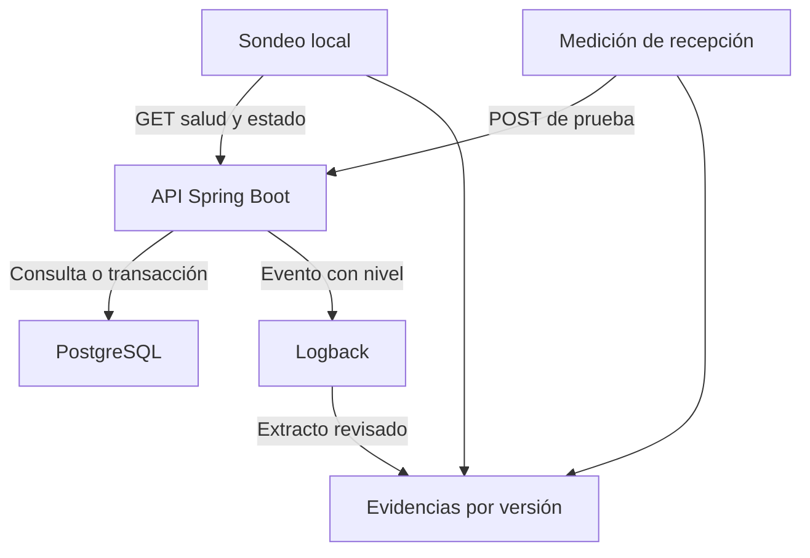

# Plan de monitoreo de ACOPIO
Equipo 1 · Integrador I · 21/11/2026 · Propuesta de trabajo para la entrega final  
Responsable del monitoreo: Elías Jhonny Ccama Ynca. Base documental: main, db9e3335e59d72dc8a22e8a0c45f9b14473d4fc0 (20/11). El commit probado se completa después de ejecutar. Patricio lleva mantenimiento; Fernando incorpora los resultados al informe.

## Qué vamos a comprobar
Queremos saber si ACOPIO atiende solicitudes, si puede leer PostgreSQL, si una recepción nueva tarda menos de dos segundos y qué señales permiten investigar un fallo. El alcance es una instalación académica local. No se prometen disponibilidad mensual ni rendimiento de producción a partir de una demostración.

| Señal | Herramienta y frecuencia propuesta | Criterio y respuesta | Evidencia |
|---|---|---|---|
| Salud de la API | GET /actuator/health, cada 60 s durante la sesión. En la demostración: tres muestras, con 5 s entre rondas. | HTTP 200 y status UP. Registrar un fallo de inmediato, repetir y avisar al responsable del backend si persiste. | JSON del sondeo con hora, HTTP y duración. |
| Acceso a PostgreSQL | GET /api/estado en la misma ronda. La ruta consulta la base. | HTTP 200, estado CONECTADO, PostgreSQL y nueve tablas en esta versión. Si cambia el esquema, revisar la migración y actualizar el criterio. Si ambas rutas fallan, el sondeo por sí solo no identifica la causa. | JSON del sondeo y, si hace falta, diagnóstico local de Verificar.cmd. |
| Tiempo de registro de un lote | Cliente HTTP de la prueba Maven: una alta de calentamiento y 20 altas consecutivas con UUID distintos, en acopio_test. Repetir tras cambios en recepción o antes de la entrega. | Meta del equipo: menos de 2 s. Propuesta para el piloto: informar tiempos individuales, cantidad desde 2 000 ms inclusive, máximo y percentil 95 de altas válidas. Registrar aparte todo fallo. Si se supera la meta, revisar backend y base y repetir en iguales condiciones. | CSV y resumen de la corrida, con commit y entorno. |
| Errores y advertencias | Revisar Logback al inicio y después de cada incidente; controlar fallos HTTP de cada ronda. | INFO para operaciones confirmadas; WARN para un conflicto previsto; una excepción inesperada o un 5xx se investiga. Separar avisos del sondeo de logs del backend. Nunca contar un rechazo de leche como una caída técnica. | Extracto saneado y descripción: qué ocurrió, qué se hizo y cómo se confirmó recuperación. |
| Memoria de Java | JConsole local del JDK, proceso del backend → Memoria → Heap. Tomar tres lecturas separadas, por ejemplo cada minuto durante la prueba. | Umbral de revisión propuesto: más del 80 % del máximo en tres lecturas seguidas. Comparar la tendencia y las pausas; una lectura alta sola no prueba una fuga. | Captura de la gráfica o tabla con hora, usado, máximo y porcentaje. |
| Recepciones por calidad | Contar UUID distintos aprobados y rechazados en el centro y período de pruebas, antes y después del recorrido. Contrastar con el reporte. | Cada alta confirmada incrementa su estado una vez; un reintento no debe duplicarla. Investigar diferencias. No publicar datos de usuarios. | Tabla con período, centro de prueba, recuentos esperados y observados. |

Los umbrales de frecuencia, memoria y número de muestras son propuestas para este piloto; el documento del equipo sí fija la meta de respuesta inferior a 2 s. El tiempo del sondeo y el del POST se conservan separados. El percentil 95 es el valor en la posición 19 de 20 tiempos ordenados si las 20 altas fueron válidas.

## Flujo de monitoreo para el diagrama del informe

Para la medición de recepción, la base es exclusivamente acopio_test. El sondeo consulta la instancia del puerto seleccionado. El diagrama muestra el flujo que se va a demostrar; vincularlo al commit efectivamente probado antes de incorporarlo como figura definitiva.

## Evidencias y criterio de cierre
1. Anotar commit, fecha y zona horaria, versión de Java y PostgreSQL, puerto/entorno de prueba y responsable. Usar datos ficticios. No conservar cabeceras de autorización, correos privados, claves ni logs de arranque completos.
2. Con el backend operativo, guardar los dos diagnósticos válidos. Dirigir después el sondeo a un puerto local comprobado como libre: debe señalar error. Volver al puerto correcto y guardar la respuesta recuperada. El puerto libre demuestra detección de falta de respuesta; no demuestra que PostgreSQL se cayó.
3. Guardar las 20 mediciones del registro o documentar el bloqueo. No descartar intentos lentos o fallidos. El token se prepara previamente: esta medida no incluye iniciar sesión, sincronizar por red móvil ni carga concurrente.
4. Revisar INFO y WARN de casos ficticios y la detección de ERROR. En el backend actual existen recepcion_confirmada (INFO) y recepcion_conflictiva (WARN). Señalar si el ERROR proviene del monitor o del backend. Si se añade un registro de excepción, comprobarlo en un entorno aislado y verificar que no imprima secretos.
5. Adjuntar las lecturas de memoria y el cuadro de calidad. Conservar fuentes y resultados, enlazarlos en el README y completar la tabla del informe. Si falta algo: dejar estado pendiente o bloqueado, causa y siguiente paso.
6. Integrar por el flujo acordado con el equipo y repetir salud y una verificación del recorrido en el commit integrado. Indicar claramente qué pruebas de rendimiento pertenecen a cada commit.

## Fuentes del proyecto
- Consigna y rúbrica del Proyecto Final, págs. 2, 4 y 6 (monitoreo, anexo y estándar de 5 puntos).
- ACOPIO: lo que tenemos y lo que falta, 13/11/2026, filas Monitoreo, Pruebas e Informe.
- README, logback-spring.xml, application.properties, EntornoRepository y LoteService en el [código revisado](https://github.com/serchiove/milk-traceability-offline/tree/db9e3335e59d72dc8a22e8a0c45f9b14473d4fc0).
