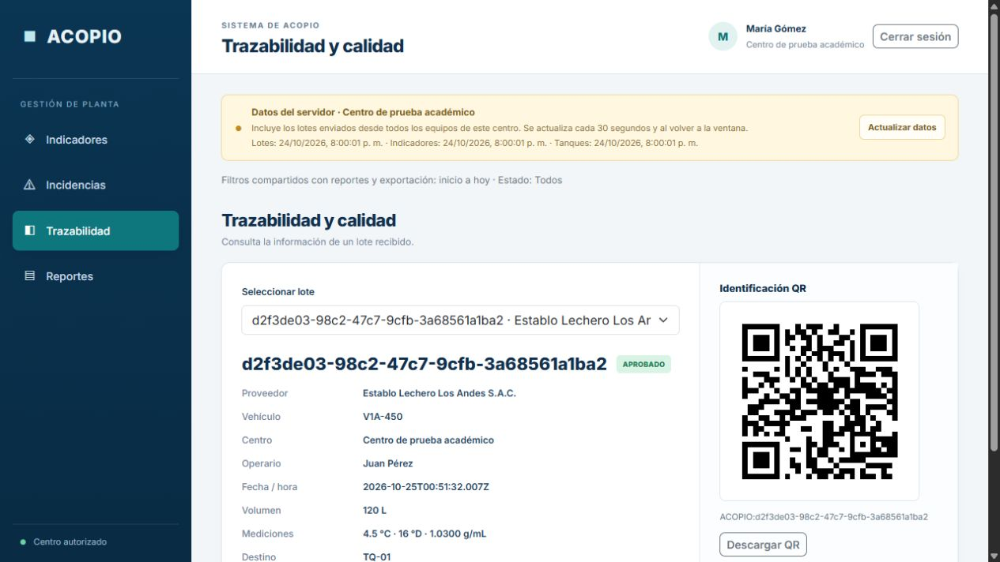

# Evidencias del recorrido de ACOPIO

Fecha: 24 de octubre de 2026.

El recorrido fue ejecutado por Sergio en el celular y el dashboard local. Las primeras cuatro capturas se conservan tal como fueron aportadas. La quinta corresponde a la verificación posterior de las correcciones del dashboard.

## Recepción en campo y conservación local

La recepción utiliza el proveedor Establo Lechero Los Andes S.A.C., vehículo V1A-450 y Centro de prueba académico, con volumen de 120 L, temperatura de 4,5 °C, acidez de 16 °D y densidad de 1,0300 g/mL.

- [Revisión antes de guardar](evidencias/recorrido-2026-10-24/02-revision-recepcion.png): muestra los datos capturados y el aviso de guardado local. El desbordamiento del nombre del centro observado en esta imagen se corrigió después.
- [Recepción local pendiente](evidencias/recorrido-2026-10-24/03-registro-local-pendiente.png): muestra que el registro está guardado en el dispositivo y todavía no fue confirmado por el servidor.
- [Fallo de conexión al enviar](evidencias/recorrido-2026-10-24/04-fallo-envio-conserva-registro.png): muestra que el registro sigue en el celular y permite reintentar.

## Recepción en el servidor y destino

[La captura inicial del dashboard](evidencias/recorrido-2026-10-24/01-dashboard-lote-aprobado.png) muestra el lote `d2f3de03-98c2-47c7-9cfb-3a68561a1ba2`, aprobado por las reglas DEMO-1 y asignado a TQ-01. El valor del QR ya existía en la respuesta del servidor, pero todavía se mostraba como texto.

## Verificación posterior del dashboard

Se inició sesión como JEFATURA en el navegador local, se abrió Trazabilidad y se consultó el mismo lote existente. Después de recargar se mantuvieron la cuenta, la pantalla y el lote seleccionado. La imagen QR quedó visible y descargable. También se comprobó que cerrar sesión y recargar regresa al acceso.

La generación del QR utiliza únicamente el valor confirmado por el servidor y se ejecuta en el navegador. La sesión se conserva en esa pestaña mientras el token siga vigente; no se guarda la contraseña.

Las cuatro capturas aportadas no incluyen imágenes del escaneo del QR ni de las exportaciones. La confirmación del usuario del recorrido completo y lo que se observa directamente en cada imagen se registran por separado.
