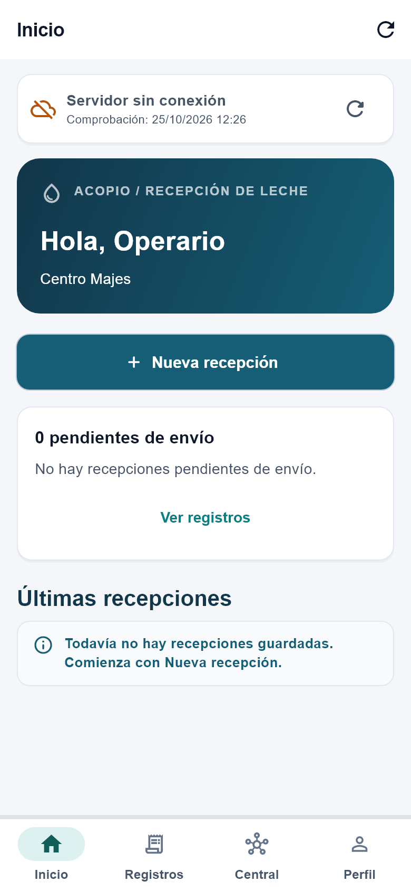
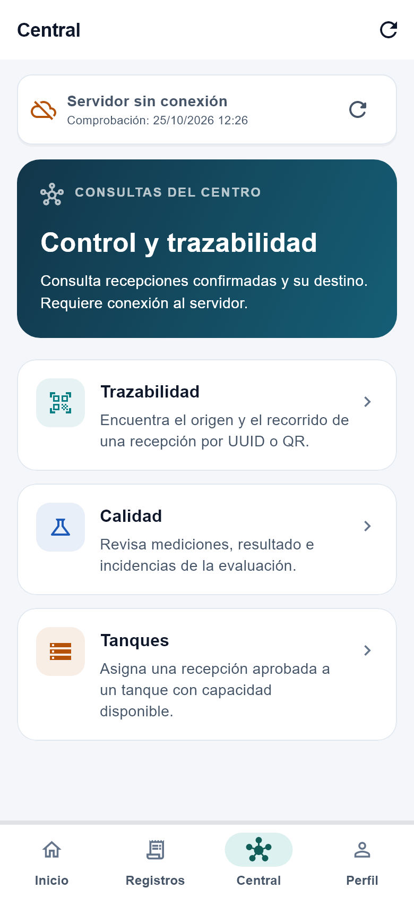
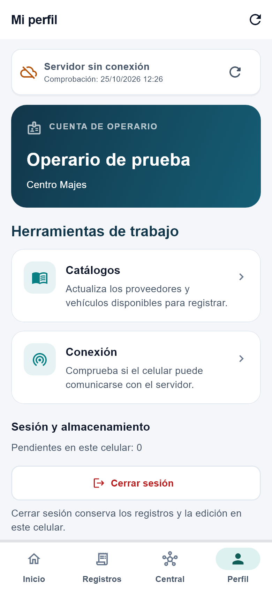

# ACOPIO

Organización y experiencia de usuario de la aplicación móvil

## Flutter y Dart

Arquitectura MVVM

## Avance de Proyecto Final 3

Registro, validación y trazabilidad del acopio lácteo

---

# Menús organizados por tarea

## Inicio

Nueva recepción, pendientes y actividad reciente.

## Registros

Datos guardados en el celular; búsqueda y reintento.

## Central

Trazabilidad, calidad y asignación de tanque.

## Perfil

Cuenta, catálogos y comprobación de conexión.

---

# Inicio

Registrar y resolver pendientes

## Una acción principal

Nueva recepción visible desde el inicio.

## Estado del trabajo

Pendientes de envío y últimas recepciones en un mismo lugar.

*Interfaz actual con datos ficticios de prueba.*

---

# Central

Consultas del servidor

## Trazabilidad

Buscar una recepción por UUID o QR.

## Calidad

Consultar evaluación e incidencias.

## Tanques

Asignar un destino con capacidad disponible.

*Interfaz actual con datos ficticios de prueba.*

---

# Clases separadas por responsabilidad

## Vistas

HomeView · RecordsView · CaptureView
Presentan datos y reciben acciones.

## ViewModels

WorkspaceViewModel · CentralViewModel
Mantienen estado y coordinan operaciones.

## Persistencia y servicios

LocalRepository · ApiClient · SyncService
Guardan datos y comunican con la API.

---

# Componentes visuales reutilizables

## AppColors y tema

Paleta, tipografía y estilos compartidos.

## SectionIntro y MenuAction

Encabezados y opciones de menú consistentes.

## PrimaryButton y StateBadge

Acciones principales y estados identificables.

*Interfaz actual con datos ficticios de prueba.*

---

# Captura local y confirmación del servidor

## 01 · Capturar

Proveedor, vehículo y mediciones. Revisión antes del guardado.

## 02 · Guardar y enviar

Persistencia local en SQLite. Reintento con el mismo UUID.

## 03 · Evaluar y consultar

Evaluación central y persistencia en PostgreSQL. Asignación de tanque y consulta desde jefatura.

---

# Validación de la revisión visual

## 46 pruebas locales aprobadas

Incluyen navegación y adaptación a pantallas estrechas.

## Compilación Android

Análisis estático sin incidencias y APK de depuración generado.

## Comprobación pendiente

Recorrido de esta versión visual en el teléfono con el backend activo.
